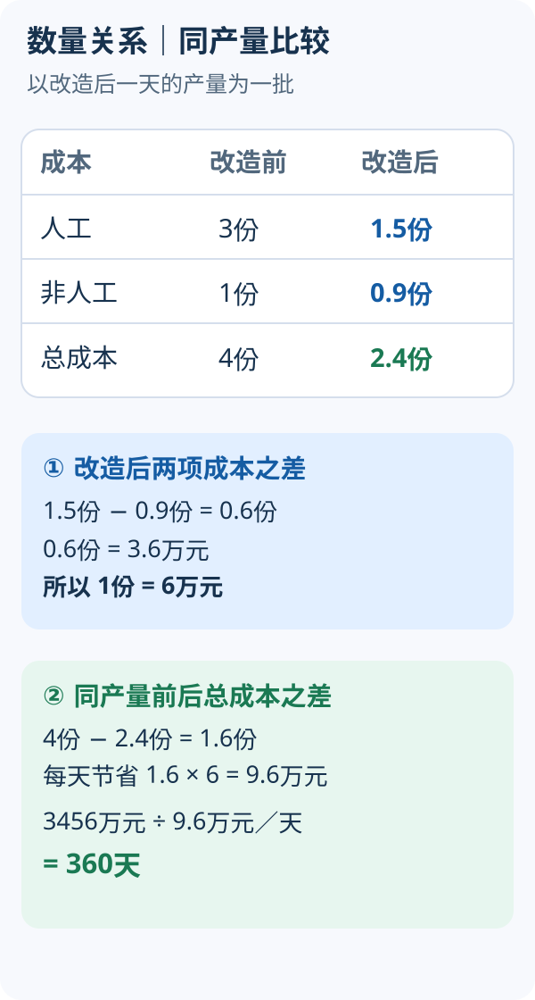

# 数量关系｜生产线改造：同产量比较成本

**本次只复盘原卷第4题。** [粉笔原卷](https://spa.fenbi.com/ti/exam/solution/1_1_41jl569?routecs=xingce&examcatid=1000187)显示5/5、总用时7分03秒；复盘日期2026-11-23，实际作答日期未单独确认。

## 第4题｜相同产量下的单位成本与每日节省 {#q4}

**复盘类型：答对复习 · 不确定 · 耗时较长。** 首答C、平台参考C；3分16秒。本人说思路和解析一致，但思维逻辑没有搞清楚，觉得是误打误撞做对；未明确说凭空猜选，不另标“猜题”。

### 原题与全部选项

某企业<mark class="rv-period">花费3456万元</mark>改造了一条自动化生产线，<mark class="rv-object">单位产品人工成本降低了50%，非人工成本降低了10%</mark>，<mark class="rv-period">单日产量扩大了一倍</mark>，已知改造前的单位产品人工成本是非人工成本的3倍，改造后每天的人工成本比非人工成本高3.6万元。问<mark class="rv-target">多少天后新生产线降低的成本可与花费的改造成本相抵</mark>？

- A 480
- B 300
- C 360
- D 540

题源：粉笔标注2023年山东省公务员录用考试《行测》试题（网友回忆版）第44题；平台参考C，未独立核验考试机关原卷。

### 本人思路

本人表示列式思路与平台解析一致，但没有搞清每一步的逻辑，认为是误打误撞答对。具体原始算式没有逐行提供，不补造其草稿或每一步的耗时。

### 最终正确解析

题目给出的是**改造后每天人工成本与非人工成本之差**；要求的是**生产相同数量的产品时，改造前后每天总成本的差**。以“改造后一天的产量”为同一批产品，设改造前生产这一批的非人工成本为1份：

| 同一批产品 | 改造前 | 改造后 |
|---|---:|---:|
| 人工成本 | 3份 | $3\times(1-50\%)=1.5$份 |
| 非人工成本 | 1份 | $1\times(1-10\%)=0.9$份 |
| 总成本 | 4份 | 2.4份 |

改造后两种成本之差是 $1.5-0.9=0.6$ 份，对应每天3.6万元，因此1份为6万元。生产同一批的总成本由4份降到2.4份，每天节省 $1.6\times6=9.6$ 万元；回本天数 $3456/9.6=360$ 天，选C。

**与平台赋值法对应。** 如果将改造前日产量看成1份产量、改造后看成2份产量，设改造前每份产量的非人工成本为 $x$ 万元，则改造后每日两种成本之差为 $(1.5x-0.9x)\times2=3.6$，得 $x=3$；每天节省 $(1.5x+0.1x)\times2=9.6$ 万元。这里 $x$ 对应赋值后的“每份产量”成本，不据此声称现实中每件产品成本恰为3万元。

### 易错提醒

先区分“单位产品成本”和“每天成本”，再把要比较的前后成本放在**相同产量**上。3.6万元对应改造后的两类成本差；节省量对应改造前后总成本差。用改造后一天的产量做一批时，产量倍数已包含在这一批里，不再重复乘2。

**记录边界：** 原卷为答对，不能改成错题；“逻辑不稳”来自本人自述，题目用时来自平台，尚未有同题闭卷重做或陌生题独立验证。
