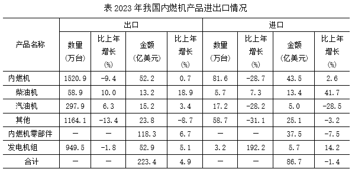

# 11月6日每日真题｜四错题与两道不确定题

提交11月7日；行测4/8、12分钟。以下6题纳入统一错题本，单题用时未知；第6题本人思路与犹豫原因已补，其他题逐题讨论接续归档。原卷正确性不改，不把不确定记为猜题、不会或独立掌握。批改已归档，逐题本人思路与后续验证待补。

[原试卷](/daily-quizzes/2026-11-06) · [首答](/daily-quizzes/2026-11-06-answer) · [结果报告](/daily-quizzes/2026-11-06-review)

## 第2题｜双空一起核对 {#q2}

**复盘类型：错题。** 首答C，参考B；单题用时未知。本人具体思路待补。

原题与全部选项

来源：2025年江苏省考《行测》A类，原第37题（网友回忆版）。[题源](https://raw.githubusercontent.com/ERRRC/xingcezhenti/278984401124db40da5163a31275b8deb9c282f4/03-%E8%A8%80%E8%AF%AD%E7%90%86%E8%A7%A3%E4%B8%8E%E8%A1%A8%E8%BE%BE/2025%E5%B9%B4%E6%B1%9F%E8%8B%8F%E7%9C%81%E5%85%AC%E5%8A%A1%E5%91%98%E5%BD%95%E7%94%A8%E8%80%83%E8%AF%95%E3%80%8A%E8%A1%8C%E6%B5%8B%E3%80%8B%E9%A2%98%EF%BC%88A%E7%B1%BB%EF%BC%89%EF%BC%88%E7%BD%91%E5%8F%8B%E5%9B%9E%E5%BF%86%E7%89%88%EF%BC%89.md)。

目前，我国快递业务已经达到了前所未有的新高度，业务量已突破1000亿件大关。快递物流是经济活力            的“风向标”，不仅            出行业的蓬勃跃升，更彰显了我国经济的繁荣活力与无限潜能。

依次填入画横线部分最恰当的一项是：

- **A**. 毋庸置疑 显示

- **B**. 名副其实 映照

- **C**. 当之无愧 折射

- **D**. 理所当然 展示

### 最终解析与易错提醒

参考B。数据说明快递物流确实具有“风向标”的作用，“名副其实”贴合名实相符；“映照出”搭配合适。“当之无愧”侧重称号当得起，与这里数据印证名实的语境不如B贴切。不要只凭第二空“折射”顺口就确定整组。

## 第3题｜交叉与种属分开 {#q3}

**复盘类型：错题。** 首答D，参考A；单题用时未知。本人具体思路待补。

原题与全部选项

来源：2025年江苏省考《行测》A类，原第78题（网友回忆版）。[题源](https://raw.githubusercontent.com/ERRRC/xingcezhenti/278984401124db40da5163a31275b8deb9c282f4/05-%E5%88%A4%E6%96%AD%E6%8E%A8%E7%90%86/2025%E5%B9%B4%E6%B1%9F%E8%8B%8F%E7%9C%81%E5%85%AC%E5%8A%A1%E5%91%98%E5%BD%95%E7%94%A8%E8%80%83%E8%AF%95%E3%80%8A%E8%A1%8C%E6%B5%8B%E3%80%8B%E9%A2%98%EF%BC%88A%E7%B1%BB%EF%BC%89%EF%BC%88%E7%BD%91%E5%8F%8B%E5%9B%9E%E5%BF%86%E7%89%88%EF%BC%89.md)。

本土药材：野生药材：名贵药材

- **A**. 沿海高铁：跨省高铁：城际高铁

- **B**. 牛奶产业：传统产业：养殖产业

- **C**. 超限车辆：超载车辆：超重车辆

- **D**. 社区治理：社会治理：水土治理

### 最终解析与易错提醒

参考A。本土、野生、名贵是不同分类维度，可以交叉；沿海、跨省、城际也可以交叉。你选D中的“社区治理”属于“社会治理”，是种属包含；这与题干关系不一致。“同属治理”不足以证明三组词关系相同。

## 第5题｜两列记账连接条件 {#q5}

**复盘类型：不确定（答对）。** 首答A，参考A；单题用时未知。本人具体思路待补。

原题与全部选项

来源：2025年江苏省考《行测》A类，原第63题（网友回忆版）。[题源](https://raw.githubusercontent.com/ERRRC/xingcezhenti/278984401124db40da5163a31275b8deb9c282f4/04-%E6%95%B0%E9%87%8F%E5%85%B3%E7%B3%BB/2025%E5%B9%B4%E6%B1%9F%E8%8B%8F%E7%9C%81%E5%85%AC%E5%8A%A1%E5%91%98%E5%BD%95%E7%94%A8%E8%80%83%E8%AF%95%E3%80%8A%E8%A1%8C%E6%B5%8B%E3%80%8B%E9%A2%98%EF%BC%88A%E7%B1%BB%EF%BC%89%EF%BC%88%E7%BD%91%E5%8F%8B%E5%9B%9E%E5%BF%86%E7%89%88%EF%BC%89.md)。

甲、乙两瓶质量和浓度均相同的酒精溶液，在甲瓶中加入20克水、乙瓶中加入50克浓度为30%的酒精溶液后，浓度仍然相等。若继续在甲瓶中加入30克纯酒精，溶液又恢复到最初浓度，则乙瓶酒精溶液最初的质量是（    ）。

- **A**. 100克

- **B**. 110克

- **C**. 120克

- **D**. 150克

### 最终解析与易错提醒

参考A，100克。设两瓶原质量均为$m$克、浓度均为$c$。

| 甲瓶时点 | 溶液总质量 | 酒精质量 |
|---|---:|---:|
| 原来 | $m$ | $mc$ |
| 加20克水 | $m+20$ | $mc$ |
| 再加30克纯酒精 | $m+50$ | $mc+30$ |

恢复原浓度给出：

$$mc+30=c(m+50)\quad\Rightarrow\quad c=\frac{30}{50}=60\%$$

中间两瓶浓度相等，再连接两列：

$$\frac{0.6m}{m+20}=\frac{0.6m+50\times0.30}{m+50}$$

$$0.6m(m+50)=(0.6m+15)(m+20)\quad\Rightarrow\quad m=100\text{克}$$

代回：甲加水后$60/120=50\%$；乙加入溶液后$75/150=50\%$；甲再加纯酒精后$90/150=60\%$。两条件都满足。中间浓度不必先知道，也不能把加入50克溶液当成加入50克酒精。

## 第6题｜同口径比较单价升降 {#q6}

**复盘类型：不确定（答对）。** 首答D，参考D；单题用时未知。本人思路及公式混淆原因已补（11月7日）。

原题与全部选项

来源：2025年江苏省考《行测》A类，原第129题（网友回忆版）。[题源](https://raw.githubusercontent.com/ERRRC/xingcezhenti/278984401124db40da5163a31275b8deb9c282f4/06-%E8%B5%84%E6%96%99%E5%88%86%E6%9E%90/2025%E5%B9%B4%E6%B1%9F%E8%8B%8F%E7%9C%81%E5%85%AC%E5%8A%A1%E5%91%98%E5%BD%95%E7%94%A8%E8%80%83%E8%AF%95%E3%80%8A%E8%A1%8C%E6%B5%8B%E3%80%8B%E9%A2%98%EF%BC%88A%E7%B1%BB%EF%BC%89%EF%BC%88%E7%BD%91%E5%8F%8B%E5%9B%9E%E5%BF%86%E7%89%88%EF%BC%89.md)。

### 给定资料

2023年我国机电产品进出口总额29025亿美元，比上年增长0.1%，占货物进出口总额的比重为49.0%。其中，出口19750亿美元，增长2.6%，占货物出口总额的比重为58.5%；进口9275亿美元，下降5.5%，占货物进口总额的比重为36.3%。

### 问题

2023年我国柴油机、汽油机的下列进出口指标值比上年高的是：

- **A**. 柴油机出口平均价格、汽油机进口平均价格

- **B**. 柴油机进口平均价格、汽油机出口平均价格

- **C**. 汽油机出口平均价格、汽油机进口平均价格

- **D**. 柴油机出口平均价格、柴油机进口平均价格

### 本人思路（11月7日补充）

> 我就根据 两期平均值的公式去判断的 直接比较a与b的大小a为分子的增长率 b为分母的增长率；柴油机的的出口和进口的 金额增长率都高于数量增长率 那肯定就是正 所以选D

> 这道题还是把握住了 但是我在做的时候 对于平均值的公式和比重的公式记混了 所以犹豫了 这方面 我觉得可以在总结积累一下

本人已正确对应金额/数量并比较a与b；当时犹豫的原因明确为平均值与比重公式混淆。原首答D及当时不确定状态保留；单题用时未知，陌生同类题独立掌握待验证。

[平均数与比重公式辨析](/xingce/平均数与比重-先辨问法再选公式)：两类指标判断升降都比较a与b；常规定量计算分别记平均数增长率与两期比重差。

### 最终解析与易错提醒

参考D。平均价格＝金额／数量，先固定产品、进出口方向和同一时期。

$$\frac{\text{本年单价}}{\text{上年单价}}=\frac{1+\text{金额增速}}{1+\text{数量增速}}$$

在本题数量与金额均为正的条件下，金额增速大于数量增速，单价上升。

| 产品方向 | 金额增速 | 数量增速 | 单价变化 |
|---|---:|---:|---|
| 柴油机出口 | 18.9% | 10.0% | 上升 |
| 柴油机进口 | 41.7% | **7.3%** | 上升 |
| 汽油机出口 | 3.4% | 6.3% | 下降 |
| 汽油机进口 | −28.5% | −28.2% | 下降 |

进口汽油机的−28.5%小于−28.2%，不能取绝对值后反过来比较。这里判断升降即可，无须逐个算出单价。表中柴油机进口数量增速按原图为7.3%。

## 第7题｜每个公民不等于劳动者 {#q7}

**复盘类型：错题。** 首答B，参考C；单题用时未知。本人具体思路待补。

原题与全部选项

来源：2025年江苏省考《行测》A类，原第8题（网友回忆版）。[题源](https://raw.githubusercontent.com/ERRRC/xingcezhenti/278984401124db40da5163a31275b8deb9c282f4/01-%E6%94%BF%E6%B2%BB%E7%90%86%E8%AE%BA/2025%E5%B9%B4%E6%B1%9F%E8%8B%8F%E7%9C%81%E5%85%AC%E5%8A%A1%E5%91%98%E5%BD%95%E7%94%A8%E8%80%83%E8%AF%95%E3%80%8A%E8%A1%8C%E6%B5%8B%E3%80%8B%E9%A2%98%EF%BC%88A%E7%B1%BB%EF%BC%89%EF%BC%88%E7%BD%91%E5%8F%8B%E5%9B%9E%E5%BF%86%E7%89%88%EF%BC%89.md)。

习近平总书记强调，就业是最基本的民生，事关人民群众切身利益，事关经济社会健康发展，事关国家长治久安。要实施就业优先战略，促进高质量充分就业。关于促进高质量充分就业，下列表述正确的是：

①在宏观层面，高质量充分就业主要包括就业机会充分、就业环境公平、就业结构优化、人岗匹配高效、劳动关系和谐等

②在微观层面，高质量充分就业主要表现为每个公民不仅有活干，而且工作稳定、收入合理、保障可靠、职业安全等

③高质量充分就业是一个很高的要求，也是一个循序渐进的过程，必须尽力而为、量力而行；必须充分调动人民群众的积极性主动性创造性，引导大家依靠努力奋斗创造幸福生活

④促进高质量充分就业。要始终坚持就业优先，着力解决结构性就业矛盾，完善重点群体就业支持政策，深化就业体制机制改革，加强劳动者权益保障

- **A**. ①②③

- **B**. ①②④

- **C**. ①③④

- **D**. ②③④

### 最终解析与易错提醒

参考C，即①③④。②把“劳动者”扩大成“每个公民”。有就业愿望、就业能力及参与劳动的对象，与每个公民不是同一范围；原文表述为“劳动者”。你选B含②，因此错误。核对原文时保留对象限定，不因多数句子熟悉就整组放过。

## 第8题｜热棒保护冻土 {#q8}

**复盘类型：错题。** 首答C，参考D；单题用时未知。本人具体思路待补。

原题与全部选项

来源：2025年江苏省考《行测》A类，原第20题（网友回忆版）。[题源](https://raw.githubusercontent.com/ERRRC/xingcezhenti/278984401124db40da5163a31275b8deb9c282f4/02-%E5%B8%B8%E8%AF%86%E5%88%A4%E6%96%AD/2025%E5%B9%B4%E6%B1%9F%E8%8B%8F%E7%9C%81%E5%85%AC%E5%8A%A1%E5%91%98%E5%BD%95%E7%94%A8%E8%80%83%E8%AF%95%E3%80%8A%E8%A1%8C%E6%B5%8B%E3%80%8B%E9%A2%98%EF%BC%88A%E7%B1%BB%EF%BC%89%EF%BC%88%E7%BD%91%E5%8F%8B%E5%9B%9E%E5%BF%86%E7%89%88%EF%BC%89.md)。

当人们乘坐列车进藏时，会在青藏铁路旁发现一个特别的景象，路基两旁时不时会闪过一排排金属管，这些金属管插入地底，露出地面的部分高达两米（如图所示）。关于这些金属管的作用，下列说法正确的是：

- **A**. 收集传导气象信息

- **B**. 实时监控路基安全

- **C**. 阻挡动物横穿铁路

- **D**. 保护冻土层的结构

### 最终解析与易错提醒

参考D。图片中的金属管为保护冻土的热棒，将路基中的热量传至空气，减缓冻土融化，保持地基稳定。C“阻挡动物横穿铁路”不是其作用。你的具体判断过程未提供，不能据选项反推你当时只看了外形。

## 权威核对

- [高质量充分就业原文](https://www.miit.gov.cn/xwfb/szyw/art/2024/art_86d2fba2f920400097b265ccc2adfd2d.html)。
- [中国科学技术馆：青藏铁路热棒](https://www.cdstm.cn/museum/zphc/ggkfssznz/art/2018/art_110db7a3f34344ae9c938d9da0c3a850.html)。

2026-11-07重新读取。题库解析为参考，不冒充官方答案。
