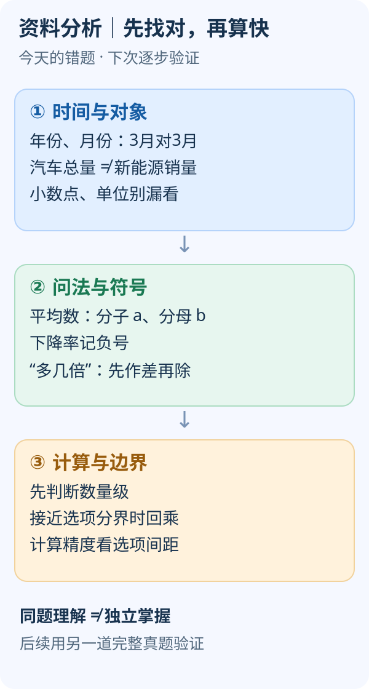
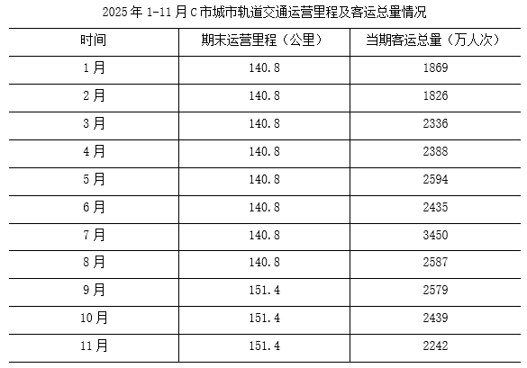
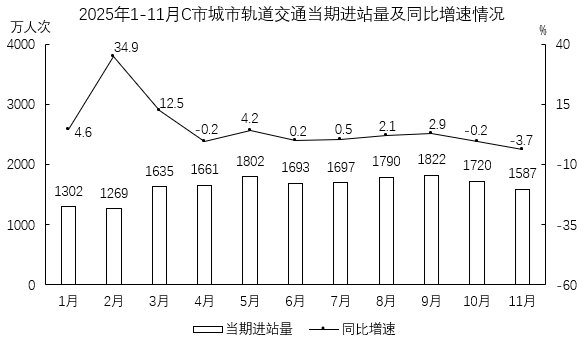

# 资料分析｜时间、对象、符号与计算

**本次只复盘两套资料分析的错题，共11题。** 本人说两套均为今天所做，2026-11-23讨论整理；题源与参考答案采用粉笔页面的标注，网友回忆版不当作考试机关原卷。首答、事后理解与陌生题独立运用分开记录。

| 套次 | 原练习 | 原卷成绩与用时 | 本次复盘题号 |
|---|---|---|---|
| 第一套 | [粉笔原卷](https://spa.fenbi.com/ti/exam/solution/1_1_41jc4o9?routecs=xingce&examcatid=1000187) | 15/21，25分01秒 | 1、3、10、12、15、16 |
| 第二套 | [粉笔原卷](https://spa.fenbi.com/ti/exam/solution/1_1_41jmedk?routecs=xingce&examcatid=1000187) | 16/21，25分52秒 | 7、13、14、15、20 |

题号只在各自原卷内有效，不把同一考点的两题合并成一次作答。平台显示的时间为整题用时，无法据此拆分各步骤耗时。未声明猜测的题目不补造猜测状态。

## 复盘中形成的检查动作

- **对齐时间和对象**：年份、月份、单月与累计；汽车总销量与新能源汽车销量；不要漏看小数点。
- **把问法翻成关系**：基期还原时下降率带负号；平均数增长率分清分子增长率和分母增长率；“多几倍”先写差，再除以参照量。
- **计算按边界回查**：近分界时用选项边界回乘，检查商的范围；具体精度由选项间距决定。
- **同题讨论不等于独立掌握**：后续是否能及时识别并独立作答，仍待另一道完整真题验证。

本人回顾：与记忆中曾在22分钟以内完成、正确率85%以上的表现相比，这两套更慢、正确率较低；此前对应卷的题量与难度未核实。本人感觉做到后半段更容易分心；这是本人感受，不据两套题推断原因。讨论中的35分钟框架回忆与旧题复习仅是计划，尚无执行反馈。

## 共用材料

### 第一套材料一｜2018年前三季度社会物流

2018年前三季度，S省社会物流总额35357.26亿元，同比增长6.4%，增速比上半年放缓0.7个百分点。其中，工业品物流总额16636.15亿元，同比增长0.2%，增速比上半年放缓2.1个百分点；外部流入（含进口）货物物流总额17357.31亿元，同比增长12.1%，增速比上半年加快0.8个百分点；农产品物流总额875.06亿元，同比增长11.6%，增速比上半年加快0.5个百分点；单位与居民物品物流总额457.86亿元，同比增长40.7%，增速比上半年放缓3个百分点；再生资源物流总额30.88亿元，同比下降7.0%，降幅比上半年扩大4.3个百分点。

2018年前三季度，S省物流相关行业实现总收入1912.8亿元，同比增长6.6%。其中：运输环节收入1321.9亿元，同比增长6.0%；保管环节收入226.2亿元，同比增长6.4%；邮政业收入82.8亿元，同比增长16.7%；配送、加工、包装业收入98.8亿元，同比增长6.4%。

2018年前三季度，S省社会物流总费用2682.1亿元，同比增长6.3%，比上半年放缓0.9个百分点。其中：物流运输环节总费用1854.6亿元，同比增长6.3%；保管环节总费用612.4亿元，同比增长6.4%；管理环节总费用214.9亿元，同比增长6.4%。

### 第一套材料二｜地方政府债券

2019年6月，全国发行地方政府债券8996亿元，同比增长68.37%，环比增长195.63%。其中，发行一般债券3178亿元，同比减少28.33%，环比增长117.08%，发行专项债券5818亿元，同比增长540.04%，环比增长268.46%；按用途划分，发行新增债券7170亿元，同比增长127.11%，环比增长332.71%，发行置换债券和再融资债券1826亿元，同比减少16.47%，环比增长31.75%。

2019年6月，地方政府债券平均发行期限11.1年，其中新增债券10.4年，置换债券和再融资债券13.4年；地方政府债券平均发行利率3.55%，其中新增债券3.52%，置换债券和再融资债券3.65%。

2019年1至6月，全国发行地方政府债券28372亿元，同比增长101.09%。其中，发行一般债券12858亿元，同比增长23.21%，发行专项债券15514亿元，同比增长322.38%；按用途划分，发行新增债券21765亿元，同比增长553.80%，发行置换债券和再融资债券6607亿元，同比减少38.71%。

2019年1至6月，地方政府债券平均发行期限9.3年，其中一般债券11.2年，专项债券7.8年；地方政府债券平均发行利率3.47%，其中一般债券3.53%，专项债券3.43%。

2019年全国地方政府债务限额为240774.3亿元。其中，一般债务限额133089.22亿元，专项债务限额107685.08亿元。截至2019年6月末，全国地方政府债务余额205477亿元，其中，一般债务118397亿元，专项债务87080亿元。

### 第一套材料三｜新能源汽车与动力电池

2025年12月，我国新能源汽车产销量分别为171.8万辆和171万辆，同比分别增长12.3%和7.2%，环比分别下降8.6%和6.2%。其中，纯电动车销量110.8万辆，同比增长13.8%，环比下降5.3%；插电式混动销量59.9万辆，同比下降3.7%，环比下降8.1%。2025年新能源汽车产销量分别为1662.6万辆和1649万辆，同比分别增长29%和28.2%。其中，纯电动车销量1062.2万辆，同比增长37.6%；插电式混动销量586.1万辆，同比增长14%。2025年新能源汽车渗透率（新能源汽车销量占汽车销量比重）47.9%，同比上升7个百分点；12月新能源汽车渗透率52.3%，环比下降0.9个百分点。2025年新能源汽车出口261.5万辆，同比增长1倍；12月新能源汽车出口30万辆，同比增长1.2倍，环比下降0.1%。

2025年12月，我国动力和储能电池产量201.7GWh（1GWh=100万千瓦时），环比增长14.4%，同比增长62.1%；销量199.3GWh，环比增长11.1%，同比增长57.5%。其中，动力电池销量143.8GWh，环比增长7.3%，同比增长49.2%。出口方面：12月我国动力和储能电池出口32.6GWh。其中，动力电池出口量19GWh，环比减少10.4%，同比增长47.1%，储能电池出口量13.6GWh，环比增长23.9%，同比增长52.2%。装车量方面：12月国内动力电池装车量（生产的新能源汽车上安装的所有动力电池的总能量）98.1GWh，环比增长4.9%，同比增长35.1%。

### 第二套材料一｜城市轨道交通图表

下列两图为粉笔原卷显示的同一组材料，第一张是运营里程及客运总量，第二张是进站量及同比增速。图表来源：[第二套粉笔原卷](https://spa.fenbi.com/ti/exam/solution/1_1_41jmedk?routecs=xingce&examcatid=1000187)。

### 第二套材料二｜互联网企业

2025年10月全国规模以上互联网和相关服务企业（以下简称“互联网企业”）营业收入1769亿元，实现利润总额201亿元，研发费用98亿元。

2025年1-10月，全国互联网企业实现营业收入16189亿元，同比增长9.6%，增速较上一年度同期提升4.4个百分点，较2025年1-9月减少3.9个百分点，实现利润总额1237亿元，同比下降1.9%，增速较上一年度同期减少19.3个百分点，较2025年1-9月提升8.1个百分点，研发费用累计支出862亿元，同比增长9.7%，增速较上一年度同期提升5.6个百分点，较2025年1-9月提升1.1个百分点。

2025年10月东部地区互联网企业实现营业收入1566亿元，同比下降18.6%；中部地区互联网企业实现营业收入62亿元，同比增长36.3%；西部地区互联网企业实现营业收入138亿元，同比增长53.9%；东北地区互联网企业实现营业收入2亿元，同比下降14.3%。

2025年1-10月东部地区互联网企业实现营业收入14523亿元，同比增长9.6%；中部地区互联网企业实现营业收入612亿元，同比下降1.7%；西部地区互联网企业实现营业收入1024亿元，同比增长18.1%；东北地区互联网企业实现营业收入30亿元，同比下降6.9%。

### 第二套材料三｜纸及纸板

2023年，我国制浆造纸及纸制品全行业完成纸浆、纸及纸板和纸制品产量合计29139万吨，同比增长2.63%。其中纸及纸板产量12965万吨，与2022年的12425万吨相比同比增长4.35%，增速比2022年扩大了1.71个百分点。

2023年，全国纸及纸板消费量13165万吨，同比增长6.14%，增速比2022年扩大了8.08个百分点；人均年消费量93.37千克，同比增长6.30%。

2023年，全国2567家造纸及纸板生产企业部分经济指标如下：营业收入8019亿元；成品存货440亿元，同比下降7.65%；利润总额269亿元，同比增长3.01%；资产11316亿元，同比增长2.11%；资产负债率58.05%；负债总额6569亿元，同比增长2.82%。

2023年，我国东部地区11个省（区、市）纸及纸板产量为8843万吨，占全国纸及纸板产量比例为68.2%，同比增长5.44%；中部地区8个省占比为19.2%，同比增长2.51%；西部地区12个省（区、市）占比为12.6%，同比增长1.43%。我国有18个省（区、市）纸及纸板产量超过100万吨，产量合计12597万吨，占全国纸及纸板总产量的97.16%。

## 第一套错题

### 第1题｜增量占增量：小数点与数量级 {#a-q1}

**复盘类型：错题。** 首答B → 平台参考D；2分09秒。题源：粉笔标注2020年国考副省级网友回忆版第131题。

**原题与全部选项**（材料一）：<mark class="rv-period">2018年前三季度</mark>，S省<mark class="rv-object">工业品物流总额同比增量</mark>约为同期<mark class="rv-object">社会物流总额同比增量</mark>的：

- A 超过30%
- B 10%～30%之间
- C 5%～10%之间
- D 不到5%

**本人思路。** 为追求速度只看数字，漏看小数点，把应为两千多的分母看成两百多，导致比重被放大。

**最终正确解析。** 工业品增量约为 $16636.15\times0.2\%/(1+0.2\%)\approx33.21$ 亿元；社会物流总额增量约为 $35357.26\times6.4\%/(1+6.4\%)\approx2126.75$ 亿元。比值约 $33.21/2126.75=1.56\%$，选D。

**易错提醒。** 两个同比增量先分别确认数量级和小数点，再相除。原答保留；本人未提供完整原始算式。

### 第3题｜平均数增长率：分子与分母的增速 {#a-q3}

**复盘类型：错题。** 首答A → 参考C；52秒。题源：粉笔标注2020年国考副省级网友回忆版第133题。

**原题与全部选项**（材料一）：<mark class="rv-period">2018年前三季度</mark>，<mark class="rv-object">平均每万元社会物流总额产生的物流费用</mark><mark class="rv-target">比上年同期</mark>：

- A 上升了不到1%
- B 上升了1%以上
- C 下降了不到1%
- D 下降了1%以上

**本人思路。** 两期平均数计算中把 $a$、$b$ 弄反；事后指出应先算 $6.3\%-6.4\%$。

**最终正确解析。** 平均数为物流费用÷物流总额，分子增速 $a=6.3\%$，分母增速 $b=6.4\%$。高照笔记中的平均数增长率公式为 $r=(a-b)/(1+b)$，本题 $r\approx-0.094\%$，下降不到1%，选C。公式参考：[高照《方法精讲·资料4》](https://www.scribd.com/document/993598247/2022-04-02-%E6%96%B9%E6%B3%95%E7%B2%BE%E8%AE%B2-%E8%B5%84%E6%96%994-%E9%AB%98%E7%85%A7-%E7%AC%94%E8%AE%B0-%E7%AC%94%E8%AF%95%E7%B3%BB%E7%BB%9F%E7%8F%AD%E5%9B%BE%E4%B9%A6%E5%A4%A7%E7%A4%BC%E5%8C%85-2023%E5%9B%BD%E8%80%833%E6%9C%9F)。

**易错提醒。** 先写“费用／总额”，再标 $a$、$b$；问增长率与问增长量要选对应公式。

### 第10题｜选非题：单月、累计与缺失月份 {#a-q10}

**复盘类型：错题。** 首答B → 参考C；1分10秒。题源：粉笔标注2020年青海省考A卷网友回忆版第120题。

**原题与全部选项**（材料二）：<mark class="rv-target">不能从上述资料推出</mark>的是：

A 截至2019年6月末，地方政府一般债务余额和专项债务余额都控制在限额之内。

B 2019年1至6月，地方政府一般债券的平均发行利率高于专项债券0.1个百分点。

C 2019年5月，地方政府新增债券的平均发行期限比置换债券和再融资债券短。

D 2019年地方一般债务限额比专项债务限额多25404.14亿元。

**本人思路。** B项把1至6月累计数据看成6月单月，C项没有继续看。

**最终正确解析。** B用累计利率 $3.53\%-3.43\%=0.1$ 个百分点，可以推出。C问5月，材料的期限数据仅有6月，不能推出5月的比较，选C。A分别比较余额和限额，D用 $133089.22-107685.08=25404.14$，均能推出。

**易错提醒。** 逐项核对时间：1至6月与单月6月不同；只有6月数据不能推定5月。

### 第12题｜新能源汽车与汽车总销量：确认分母 {#a-q12}

**复盘类型：错题。** 首答D → 参考A；1分05秒。题源：粉笔标注2026年河南省考网友回忆版第119题；本站较早同题记录的地区标注不同，真题卷别待独立核验。

**原题与全部选项**（材料三）：<mark class="rv-period">2025年12月</mark>，我国<mark class="rv-object">除纯电动和插电式混动之外的新能源汽车销量</mark>占<mark class="rv-object">汽车总销量</mark>的：

- A 不到0.1%
- B 0.1%～0.3%
- C 0.3%～0.6%
- D 0.6%以上

**本人思路。** 没有用到新能源汽车渗透率，把新能源汽车销量当成汽车总销量。

**最终正确解析。** 其他新能源汽车销量 $171-110.8-59.9=0.3$ 万辆；汽车总销量 $171/52.3\%\approx326.96$ 万辆；所求 $0.3/(171/52.3\%)\approx0.0918\%$，选A。

**易错提醒。** 分母是全部汽车而非新能源。如果分子为0.3而只错把171当分母，结果约0.175%，落在B；平台首答为D，其余原始计算步骤未知，不推测。讨论中助手曾误报答案，已以原卷更正为D→A。

### 第15题｜平均数差值：下降率带负号 {#a-q15}

**复盘类型：错题。** 首答B → 参考C；2分22秒。题源：粉笔标注2026年河南省考网友回忆版第117题；与本站较早同题记录的地区标注存在差异，卷别待核。

**原题与全部选项**（材料三）：<mark class="rv-period">2025年12月</mark>国内<mark class="rv-object">平均每生产1辆新能源汽车安装的动力电池能量</mark><mark class="rv-target">比上月</mark>：

- A 低不到10千瓦时
- B 低10千瓦时以上
- C 高不到10千瓦时
- D 高10千瓦时以上

**本人思路。** 能识别两期平均数之差，但把分母增长率 $b$ 的正负弄错。

**最终正确解析。** 分子是装车量，$a=+4.9\%$；分母是产量，$b=-8.6\%$。现期平均数 $98.1\times100/171.8\approx57.1$ 千瓦时/辆。现期减基期：

$$
\frac{98.1\times100}{171.8}\times\frac{4.9\%-(-8.6\%)}{1+4.9\%}\approx7.35\text{千瓦时/辆}
$$

高不到10千瓦时，选C。分子增加且分母减少，也可先判断平均数上升。

**易错提醒。** 差值公式为现期平均数乘 $(a-b)/(1+a)$；增长率公式为 $(a-b)/(1+b)$。原始完整算式未知，不推测符号之外的步骤。

### 第16题｜能否推出：缺项与混合增长率 {#a-q16}

**复盘类型：错题 · 猜题。** 首答A → 参考B；7秒。题源：粉笔标注2026年河南省考网友回忆版第120题；本站较早的同题复盘标注不同地区，卷别待核。

**原题与全部选项**（材料三）：在上述资料信息中以下<mark class="rv-target">哪项可以推出</mark>？

①2024年12月新能源汽车出口量占汽车出口量比重。

②2025年12月储能电池销量同比增长速度。

- A 仅①能从上述资料推出
- B 仅②能从上述资料推出
- C 两者都能从上述资料推出
- D 都不能

**本人思路。** 为节约时间直接猜选；事后判断①缺汽车出口总量，②可由动力与合计数据按混合增长率求出，并要求补充高照线段法。

**最终正确解析。** ①可还原新能源汽车出口量，但没有2024年12月汽车总出口量，不能求比重。②统一使用“销量”：储能现期 $199.3-143.8=55.5$ GWh；储能基期 $199.3/1.575-143.8/1.492\approx30.16$ GWh，因而同比增速可求，约84.0%。仅②可推出，选B。原题只问能否推出，列出可闭合的信息链即可，不必精算。

按高照线段法，动力、合计、储能增速依次为 $49.2\%、57.5\%、x$：

$$
\frac{x-57.5\%}{57.5\%-49.2\%}
=\frac{\text{动力基期销量}}{\text{储能基期销量}}
\approx\frac{96.38}{30.16}
$$

**易错提醒。** 部分写两边、整体写中间；混合增长率中距离与**基期量**成反比。以现期量代替只是近似，不能当精确权重；不能把产量或国内销量当作出口量。同题旧复盘见网站《135题混合真题批改》第120题。

## 第二套错题

### 第7题｜图表找数：3月与4月 {#b-q7}

**复盘类型：错题。** 首答D → 参考C；23秒。题源：粉笔标注2026年辽宁省考网友回忆版第107题。

**原题与全部选项**（材料一）：<mark class="rv-period">2024年3月</mark>C市城市轨道交通<mark class="rv-object">当期进站量</mark>在下面哪个范围内？

- A 不到1300万人次
- B 1300万～1400万人次
- C 1400万～1500万人次
- D 超过1500万人次

**本人思路。** 将3月看成了4月。

**最终正确解析。** 图中2025年3月进站量1635万人次、同比增长12.5%。按同月同比还原：$1635/(1+12.5\%)\approx1453.3$ 万人次，选C。原图中4月为1661万人次、同比下降0.2%；若同时误用这两个4月数据，会得到约1664万人次并落在D，本人未说明原始取数细节，不把该式当成其首答算式。

**易错提醒。** 求2024年3月，就找2025年3月的数及同比；年份变化时月份保持一致。

### 第13题｜利润率：用边界回查除法 {#b-q13}

**复盘类型：错题。** 首答A → 参考B；1分33秒。题源：粉笔标注2026年黑龙江省考网友回忆版第118题。

**原题与全部选项**（材料二）：<mark class="rv-period">2025年1-9月</mark>，全国互联网企业<mark class="rv-target">利润率（利润率=利润总额/营业收入）</mark>在以下哪个范围内？

- A 不到7%
- B 7%～7.5%之间
- C 7.5%～8%之间
- D 超过8%

**本人思路。** 最后的除法算错。

**最终正确解析。** 利润为 $1237-201=1036$ 亿元，营业收入为 $16189-1769=14420$ 亿元，$1036/14420\approx7.18\%$，选B。回查边界：$14420\times7\%=1009.4$，$14420\times7.5\%=1081.5$，1036在两者之间。

**易错提醒。** 累计减当月后，同口径组成分子分母；商接近分界时回乘比较。

### 第14题｜基期倍数：下降率的符号 {#b-q14}

**复盘类型：错题。** 首答C → 参考B；1分09秒。题源：粉笔标注2026年黑龙江省考网友回忆版第119题。

**原题与全部选项**（材料二）：<mark class="rv-period">2024年1-10月</mark><mark class="rv-object">西部地区互联网企业实现营业收入</mark><mark class="rv-target">是</mark><mark class="rv-object">中部地区</mark>的多少倍？

- A 不到1倍
- B 1～1.5倍之间
- C 1.5～2倍之间
- D 超过2倍

**本人思路。** 把中部同比下降1.7%当成了上升。

**最终正确解析。** 西部2024年为 $1024/(1+18.1\%)$；中部2024年为 $612/(1-1.7\%)$。两者之比约1.39，选B。

**易错提醒。** 下降率为负数。仅将下降误写成上升、其余步骤不变，算得约1.44倍仍在B，因此单靠该符号错误不能完整还原首答C；其他计算步骤未知。

### 第15题｜两期比重：增长率对应年份 {#b-q15}

**复盘类型：错题。** 首答D → 参考C；1分13秒。题源：粉笔标注2026年黑龙江省考网友回忆版第120题。

**原题与全部选项**（材料二）：<mark class="rv-target">能够从上述资料中推出</mark>的是：

A 2025年1-10月，东部地区互联网企业实现营业收入同比增速较1-9月有所增加。

B 2024年1-10月，西部地区互联网企业月平均实现营业收入超过88亿元。

C 2025年10月，中部地区互联网企业实现营业收入同比增量超过15亿元。

D 2024年1-10月，全国互联网企业研发费用占营业收入的比重较2023年同期有所提高。

**本人思路。** D项直接用了9.6%和9.7%，未先还原2024年的同比增速。

**最终正确解析。** 2024年收入增速 $9.6\%-4.4\%=5.2\%$，研发费用增速 $9.7\%-5.6\%=4.1\%$；分子增速低于分母，比重下降，D错误。C项同比增量 $62\times36.3\%/(1+36.3\%)\approx16.51$ 亿元，超过15亿元，选C。A项10月增速低于1—10月累计增速，累计相对1—9月下降；B项约 $1024/1.181/10=86.7$ 亿元，未超过88亿元。

**易错提醒。** 两期比重先标比较年份，再找到属于该年的部分与整体增速，不能把2025年增速直接用于2024年对2023年的判断。

### 第20题｜“是几倍”与“多几倍” {#b-q20}

**复盘类型：错题。** 首答B → 参考C；35秒。题源：粉笔标注2025年新疆省考网友回忆版第102题。

**原题与全部选项**（材料三）：<mark class="rv-period">2023年</mark>我国<mark class="rv-object">东部地区纸及纸板产量</mark>与<mark class="rv-object">中部地区</mark>相比<mark class="rv-target">约多</mark>：

- A 4倍以上
- B 3～4倍
- C 2～3倍
- D 1～2倍

**本人思路。** 求“多多少倍”时没有减1，自述这一问法反复出错。

**最终正确解析。** 同属全国总量，东部和中部产量之比等于占比之比，$68.2/19.2\approx3.55$ 是“东部是中部的几倍”；题问“多几倍”，$(68.2-19.2)/19.2\approx2.55$，选C。

**易错提醒。** “是几倍”用 $A/B$；“多几倍”用 $(A-B)/B=A/B-1$。先写差，再除参照量。

## 来源与记录边界

原题、参考答案与用时来自两套粉笔页面；本人错误原因及后段注意力感受来自本聊天。全卷成绩保留，不把讨论后的理解改写为首答或独立掌握。第二套仅讨论5道错题，其余题不在本页归档；数量关系第4题另见本次数量专项页。新题源的考试年份、地区、卷别均按平台标注，网友回忆版且部分与旧记录存在来源分歧，尚未以考试机关原卷核验。
