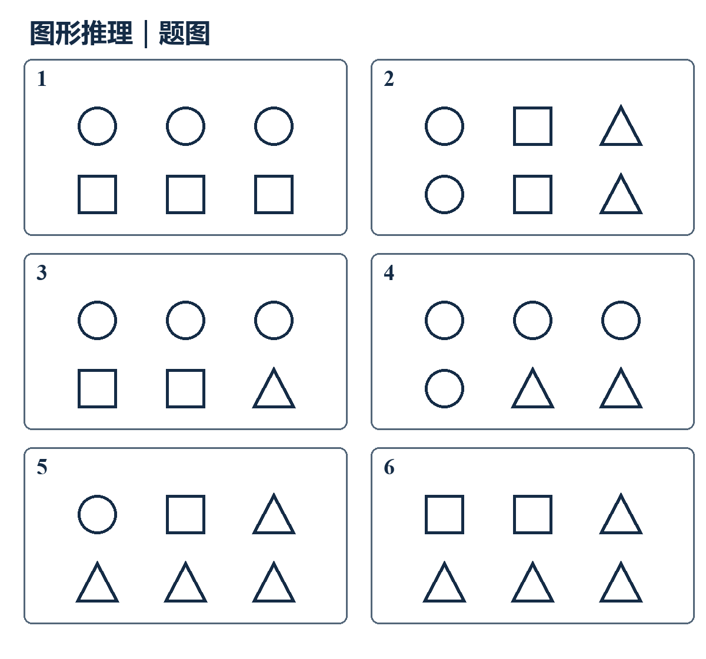

# 10月27日｜公考复测

**行测8题＋申论1题，建议35分钟，闭卷作答。** 记录真实用时，标出确定／猜测；可只报整卷总用时，不必估算单题时间。

本卷均为自编练习，不是历年真题。第7、8题为补充入门诊断，不预设已系统学习；第3题为论证加强入门诊断。图形可放大查看。交卷前不展示答案或解析。

## 第1题

①<mark class="rv-period">为解决这一矛盾</mark>，社区决定重新安排活动室的开放时间。

②<mark class="rv-period">起初</mark>，社区活动室只在工作日白天开放。

③<mark class="rv-period">但</mark>不少居民白天上班，等他们下班，活动室已经关门。

④<mark class="rv-period">调整后</mark>，活动室增加了晚间和周末的开放时段。

⑤<mark class="rv-object">这样的安排</mark>使<mark class="rv-object">原本难以到场的居民</mark>也有机会参加活动。

<mark class="rv-target">将以上五句话重新排列，语序最恰当的一项是：</mark>

A. ②①③④⑤

B. ③②①④⑤

C. ②③①④⑤

D. ②③④⑤①

## 第2题

<mark class="rv-object">下列各句中</mark>，<mark class="rv-target">没有语病的一项是：</mark>

A. 通过开展定期巡查，使设备故障得到了及时处理。

B. 工作人员逐项核对材料，并将需要补充的内容一次性告知申请人。

C. 服务中心将进一步提升办事水平和办理流程。

D. 这份调查报告的作者是三名社区工作人员共同编写的。

## 第3题

某图书馆<mark class="rv-period">增加晚间开放时段后</mark>，<mark class="rv-object">月度借阅人次</mark>上升。负责人<mark class="rv-period">据此认为</mark>，延长开放时间让<mark class="rv-object">原本白天无法到馆的读者</mark>获得了更多借阅机会。

<mark class="rv-target">以下哪项如果为真，最能支持负责人的判断？</mark>

A. 同期另一家没有延长开放时间的图书馆，借阅人次也有所增加。

B. 该馆原本计划更新阅览桌椅，但尚未实施。

C. 该馆新购图书的数量与上月相比没有明显变化。

D. 新增借阅人次主要发生在晚间新增时段，这些读者多数因白天上班而无法在原开放时段到馆。

## 第4题

把下面<mark class="rv-object">六幅图</mark><mark class="rv-period">分为两类</mark>，使每一类图形都具有共同的规律。<mark class="rv-target">下列分组最恰当的是：</mark>

<a :href="quizResultImage" target="_blank" rel="noopener">放大查看图解</a>

A. ①②③；④⑤⑥

B. ①④⑥；②③⑤

C. ①③⑤；②④⑥

D. ①②⑥；③④⑤

## 第5题

<mark class="rv-object">等差数列8，15，22，29，……</mark>的<mark class="rv-target">前41项之和，除以7所得的余数是：</mark>

A. 4

B. 5

C. 6

D. 0

## 第6题

某地区<mark class="rv-object">生产总值及其中某产业增加值</mark>的模拟数据如下，<mark class="rv-period">单位均为亿元</mark>。<mark class="rv-period">第一季度为1—3月累计，上半年为1—6月累计</mark>。

| 年份 | 第一季度生产总值 | 上半年生产总值 | 第一季度该产业增加值 | 上半年该产业增加值 |
|---|---:|---:|---:|---:|
| 2025 | 800 | 1800 | 240 | 600 |
| 2026 | 1000 | 2200 | 360 | 840 |

<mark class="rv-target">2026年第二季度，该产业增加值占该地区生产总值的比重为：</mark>

A. 约38.2%

B. 40.0%

C. 48.0%

D. 60.0%

## 第7题

<mark class="rv-object">在我国法律体系中</mark>，<mark class="rv-target">属于国家根本法、具有最高法律效力的是：</mark>

A. 宪法

B. 民法典

C. 立法法

D. 行政许可法

## 第8题

关于<mark class="rv-object">声音和光的传播</mark>，<mark class="rv-target">下列说法正确的是：</mark>

A. 声音可以在真空中传播。

B. 光必须依靠空气才能传播。

C. 声音只能在气体中传播。

D. 光可以在真空中传播，声音不能在真空中传播。

<section class="quiz-shenlun">

## 第9题

**给定材料（自编）：**

为改善乡村阅读服务，L县先让各村通过入户走访、读者座谈收集需求，并按儿童、务工人员、种植户等不同群体配置书单。对使用手机不熟练的老人，管理员提供现场登记和检索帮助。过去“书架上有什么就读什么”，逐步转向按读者需要提供图书。

一些村书屋的图书长期不更新，另一些村却有不少闲置藏书。县图书馆组织各村清点图书，建立共享目录，实行跨村通借通还，并定期轮换一批图书。读者可以在本村登记、调阅其他村的藏书，不必为了借一本书专门跑到县城。

为避免设施建好后无人管理，L县招募本地志愿者，与专职管理员一起接受借阅登记、阅读活动组织等培训；统一服务规范，安排人员定期巡检设备，记录读者反馈并跟进处理。管理人员更熟悉工作要求，发现的问题也能及时有人负责。

**问题：**<mark class="rv-object">根据材料</mark>，<mark class="rv-target">概括L县改善乡村阅读服务的主要做法。</mark>要求：<mark class="rv-period">要点完整、条理清楚</mark>，<mark class="rv-period">不超过150字</mark>。

</section>

## 交卷

- 行测：题号＋选项，标出确定／猜测；方便时补充卡住题的一句思路。
- 申论：保留首答原文。报整卷总用时，或分别报两部分用时均可。
- 当天已做任务及剩余时间可选填，用于批改后调整安排。

[结果报告（待作答）](/daily-quizzes/2026-10-27-review) · [每日入口](/daily-quizzes/)
