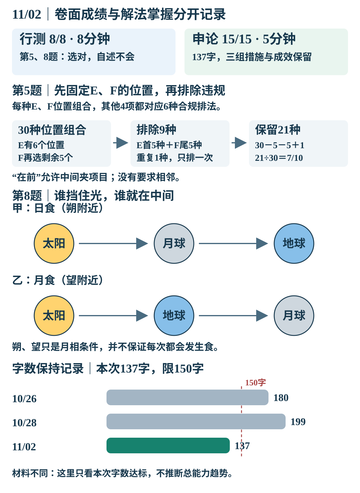

# 11月2日｜公考复测结果

**行测8/8、8分钟；第5、8题选对但本人自述不会，不记为解法已掌握。申论AI学习性15/15、5分钟，137字，三组主要措施与成效保留。合计13分钟。**

[原试卷与全部选项](/daily-quizzes/2026-11-02) · [本人首答原文](/daily-quizzes/2026-11-02-answer) · [每日入口](/daily-quizzes/)

<a class="compact-flow-link" href="/xuexi-notes/compact-flow-20261109/aligned-2def7911d7b5dd6bf900.svg" target="_blank" rel="noopener"><picture class="compact-flow"><source srcset="/compact-flow-20261109/aligned-2def7911d7b5dd6bf900.svg"></picture></a>

<a href="/xuexi-notes/compact-flow-20261109/aligned-2def7911d7b5dd6bf900.svg" target="_blank" rel="noopener">放大查看图解</a> · [查看原尺寸图](/daily-quizzes/assets/2026-11-02-复测结果.svg)

## 一眼看结果

| 维度 | 本次真实记录 | 判断边界 |
|---|---|---|
| 行测首答 | BDADBABC，与答案一致，8/8 | 保留卷面成绩，不因自述不会扣成6/8 |
| 第5题 | B，选对；本人自述不会 | 选项取得方式、是否猜选及原思路未知；不能只凭选对记方法掌握 |
| 第8题 | C，选对；本人自述不会 | 11/02七天位置关系复测未通过掌握目标，继续修复 |
| 其余6题 | 首答均正确 | 确定程度与逐题推理未说明，不替本人补写 |
| 实际用时 | 行测8分钟、申论5分钟，合计13分钟 | 单题用时、全日学习量与剩余时间未知，不均摊为单题耗时 |
| 申论 | 15/15：内容12、组织2、字数1 | AI学习性参考，按出卷前自编题口径；非官方或老师实评 |
| 字数目标 | 去表情序号、空白，含标点137字，限150字 | 本次三组信息保留并达标；不同材料的裸分不直接当能力趋势 |

## 第5题：30种位置组合，排除9种违规

<a class="compact-flow-link" href="/xuexi-notes/compact-flow-20261109/aligned-aab9878bb542c5a4c099.svg" target="_blank" rel="noopener"><picture class="compact-flow"><source srcset="/compact-flow-20261109/aligned-aab9878bb542c5a4c099.svg"></picture></a>

图解依据历史自编卷及已有解析绘制；原答和掌握状态不变。

**本人思路：** 只收到“不会”，没有具体计数过程。下面从头讲方法，不反推你当时如何选到B。

A在B前、C在D前，只规定先后，**不要求相邻**。先固定E、F的位置，剩余4个位置留给A、B、C、D。

无论E、F占哪两位，余下4项都恰有6种合规顺序：ABCD、ACBD、ACDB、CABD、CADB、CDAB。填入余下位置即可。因此每一组E、F位置组合对应同样多的完整安排，可以只数这两个项目的位置。

$$
6\times5=30\text{种位置组合}
$$

| 需要排除 | 数量 | 为什么 |
|---|---:|---|
| E是第一个 | 5 | E固定第1位，F可占其余5位 |
| F是最后一个 | 5 | F固定第6位，E可占其余5位 |
| 两项同时发生 | 1 | 只有E第1位、F第6位这一组，被上面减了两次 |

$$
\text{合格数}=30-5-5+1=21
$$

$$
P=\frac{21}{30}=\frac7{10}
$$

也可直接写成概率式：

$$
P=1-\frac16-\frac16+\frac1{30}=\frac7{10}
$$

**易错提醒：** 最后一项是加回交集，不能再减一次；两个“不是”要同时满足。用完整安排复核：满足先后的180种中，E首30种、F尾30种、二者同时6种，合格126种，126/180仍为7/10。此处是看过解析后的方法学习，未记为新的独立答对。

## 第8题：先认谁遮光，再判断朔望

<a class="compact-flow-link" href="/xuexi-notes/compact-flow-20261109/aligned-9f08181565436ef1dfeb.svg" target="_blank" rel="noopener"><picture class="compact-flow"><source srcset="/compact-flow-20261109/aligned-9f08181565436ef1dfeb.svg"></picture></a>

图解依据历史自编卷及已有解析绘制；原答和掌握状态不变。

**本人思路：** 首答C，自述不会；具体不清楚哪条、是否猜选未说明。

| 现象 | 从太阳到另一端的位置 | 月相附近 | 题中判断 |
|---|---|---|---|
| 甲：月球挡住太阳 | 太阳 → 月球 → 地球 | 朔（新月） | ①、③对应甲的部分正确 |
| 乙：月球进入地球本影 | 太阳 → 地球 → 月球 | 望（满月） | ②、③对应乙的部分正确 |

日食时挡光的是月球；月食时挡光的是地球。地球和月球的轨道平面存在夹角，所以到了朔或望，也不一定排列到产生食的合适位置。④把必要的月相条件误当成充分条件，因此错；正确①②③，选C。

依据出题日已核对的[香港太空馆：日食](https://hk.space.museum/sc/web/spm/resources/special-astronomical-events/solar-eclipse.html)与[月食](https://hk.space.museum/sc/web/spm/resources/special-astronomical-events/lunar-eclipse.html)。10/26曾错、10/28选对但不稳，本次仍自述不会：说明这条需要补解释和保持验证，不能被本次选对掩盖。

## 逐题只记三件事

按题号展开参考图；图依据历史自编题与已有解析制作。

第1题｜分别看场地

<a class="compact-flow-link" href="/xuexi-notes/compact-flow-20261109/aligned-773e40653a2473792583.svg" target="_blank" rel="noopener"><picture class="compact-flow"><source srcset="/compact-flow-20261109/aligned-773e40653a2473792583.svg"></picture></a>

第2题｜工具与理解

<a class="compact-flow-link" href="/xuexi-notes/compact-flow-20261109/aligned-1d3a89930544487f7fe0.svg" target="_blank" rel="noopener"><picture class="compact-flow"><source srcset="/compact-flow-20261109/aligned-1d3a89930544487f7fe0.svg"></picture></a>

第3题｜对应时间

<a class="compact-flow-link" href="/xuexi-notes/compact-flow-20261109/aligned-ac62530bb04e4e8940d8.svg" target="_blank" rel="noopener"><picture class="compact-flow"><source srcset="/compact-flow-20261109/aligned-ac62530bb04e4e8940d8.svg"></picture></a>

第4题｜原图标出奇点

第6题｜两期比重差

<a class="compact-flow-link" href="/xuexi-notes/compact-flow-20261109/aligned-62d54548fd8cf2f53443.svg" target="_blank" rel="noopener"><picture class="compact-flow"><source srcset="/compact-flow-20261109/aligned-62d54548fd8cf2f53443.svg"></picture></a>

第7题｜三组对应

<a class="compact-flow-link" href="/xuexi-notes/compact-flow-20261109/aligned-c730747edc96dd8378c3.svg" target="_blank" rel="noopener"><picture class="compact-flow"><source srcset="/compact-flow-20261109/aligned-c730747edc96dd8378c3.svg"></picture></a>

| 题号 | 本人首答与思路状态 | 最终解析与易错提醒 |
|---|---|---|
| 1 | B→B；思路未提供 | 砂质土重保水补水，黏质土重排水；不能把后一组重点扩大为全体 |
| 2 | D→D；思路未提供 | 转折指出只求逼真不足，例子和末句共同指向理解文物意义的路径 |
| 3 | A→A；思路未提供 | 两边均白天—夜晚；夙兴夜寐重勤劳且跨早晚，不只看“夜”字 |
| 4 | D→D；思路未提供 | 图形均连通，奇点数4、2、4、2、2、4；②④⑤可一笔，①③⑥至少两笔。也认可尾线与对角端点关系的有效分类，未据选项反推本人用了奇点法 |
| 5 | B→B；自述不会 | 30种E/F位置组合，排除5+5−1=9种，保留21种；详见上文 |
| 6 | A→A；算式未提供 | 两年下半年为全部700/850、会员410/510；60%−58.571%约1.4个百分点，全年差5个百分点不能替代 |
| 7 | B→B；补充诊断 | 科技是第一生产力、人才是第一资源、创新是第一动力；据出题日核对的[二十大报告摘要](https://www.cac.gov.cn/2022-10/17/c_1667634523614600.htm)，不据一道题判断政治模块掌握 |
| 8 | C→C；自述不会 | 甲日食、乙月食，朔望不是必然发生食的充分条件；详见位置表 |

第6题可核对：

$$
\frac{900-390}{1500-650}=60\%
$$

$$
\frac{660-250}{1200-500}=\frac{410}{700}\approx58.571\%
$$

$$
60\%-58.571\%\approx1.4\text{个百分点}
$$

<section class="quiz-shenlun">

## 申论：合并同类，保留措施与成效

**本次AI学习性15/15：三组内容各4分，共12分；配对与条理2分；150字内1分。** 依据出题前保存的自编题口径，认可同义表达，未要求照抄参考稿。

| 材料要点 | 本人已写信息 | 本次点值与理由 |
|---|---|---|
| 整合食堂、统一加工采购制作供应；提高利用率、降成本稳餐价 | 第1条完整覆盖 | 措施2＋成效2＝4/4 |
| 登记口味食量、差异餐食、反馈调菜；适口、减剩饭、满意提高 | 第2条均有，“提供相应餐食”结合已登记的口味食量认可 | 措施2＋成效2＝4/4，不强制逐字列软硬和大小份 |
| 预约、统一订单、分工路线与配送；便利目标老人、及时送达 | 第3条写了电话现场、汇总订单、分工路线及送餐及时，便利对象明确 | 措施2＋成效2＝4/4，结合题意认可配送含义 |
| 配对清楚、归类条理 | 三条分别围绕资源、需求、配送，措施后接成效 | 2/2；不因缺少统一总括标题扣分 |
| 字数 | 去三个表情序号与空白，含标点137字 | 1/1，未超150字 |

第三条可将“分工规划送餐路线”改成“分区规划路线，送餐到家”，把服务落点说得更明确。这是表达建议，不把已写的送餐和便利对象判成遗漏，也不机械扣分。

### 本次字数保持证据

| 测验日期 | 字数（同一计数口径） | 本次目标 |
|---|---:|---|
| 10/26 | 180/150 | 未达标 |
| 10/28 | 199/150 | 未达标 |
| 11/02 | 137/150 | 本次达标，三组主要措施成效保留 |

这次出现了新材料首答压字数成功的证据；不同材料的难度与满分不同，不直接比较9/10与15/15来判断总体能力变化。后续继续检验保持。

### 119字参考整理稿

整合闲置食堂，集中采购、统一制作供应，提高设备利用率，降低成本、稳定餐价。登记口味食量，提供软硬、大小份餐食，依反馈调菜，提升适配与满意度、减少浪费。电话现场预约，统一订单、分区规划路线并送餐到家，减少老人奔波和重复跑线，提高送餐及时性。

这是AI参考整理，不覆盖137字首答，也不记为本人已改写。你当前原答已在字数内，无需为了更短而整篇重写。

</section>

## 当天怎么调整

本卷已做13分钟，今天其他任务与剩余时间未知；不沿用历史可用窗口，不追加整套练习。

| 剩余时间条件 | 最小下一步 | 建议时间 | 完成标准 |
|---|---|---:|---|
| 约5分钟 | 先复述第5题的30、5、5、1各从哪里来 | 约5分钟 | 能解释为什么交集要加回，先后不等于相邻 |
| 还有约10分钟 | 上述之后，遮住位置表，画两条日月地顺序并解释朔望不必然有食 | 再约5分钟 | 两种顺序、两种月相及必要条件都说清 |
| 没有余力 | 今天到此 | 不加任务 | 等正常日卷做变式，不形成补债 |

这些是计划，不是已执行。申论目前只需保留“按组配对＋先估字数”的做法，无需增加重写负担。

## 下次复测与来源

- 11/04：日月地位置与月相的无提示变式，保留正确性和自述把握度；当天已有图推与浓度计划保留。
- 11/05：条件排列与端点限制的变式，避开11/04正常数量题已排的浓度保持项；约2天安排顺延1天，不加第二份卷。
- 11/09：上述两项约7天保持，申论150字配对保持嵌入同日短材料；均未执行，不预记通过。
- 本次月食七天项目记“已测但掌握目标未通过”；申论七天字数项目记“本题已验证”。首答、卷面成绩、解法掌握分别保存。
- [原试卷](/daily-quizzes/2026-11-02)、[本人首答](/daily-quizzes/2026-11-02-answer)和[测验台账](/daily-quizzes/#复测安排)。方法依据为现有复盘与指定OK公考讲义；自编题评分不是老师或官方答案。

本地保存、网站发布与实际验看分开核对；按既有选择，不继续配置Obsidian云同步。
