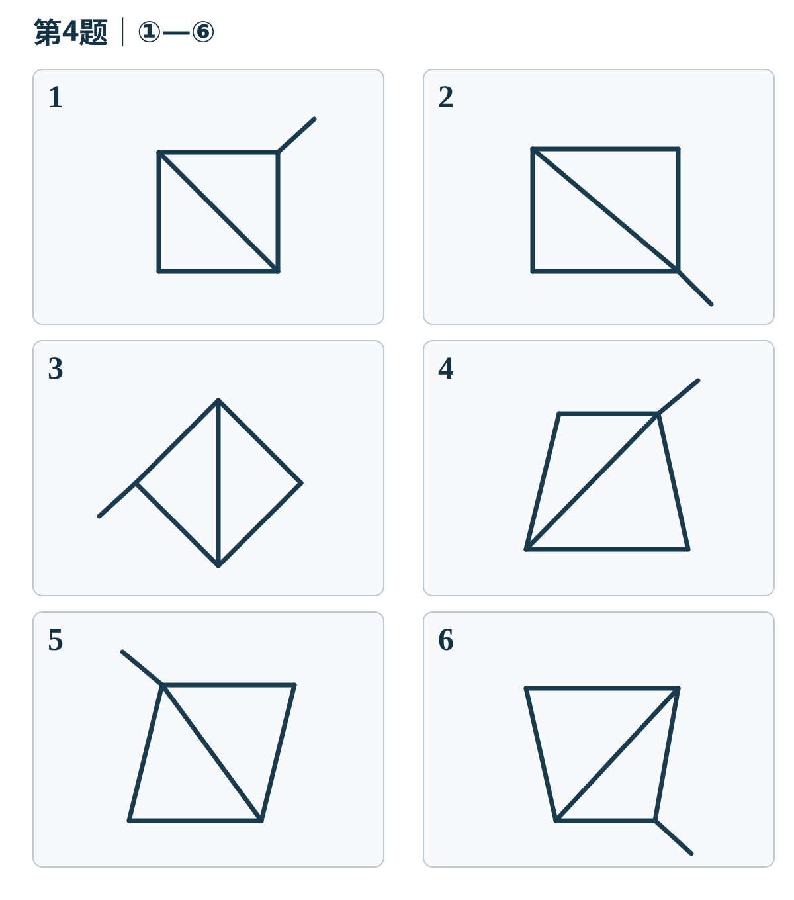

# 11月2日｜公考复测

**8道行测＋1道申论，建议35—40分钟，闭卷作答。** 本卷均为AI自编练习，结合网站当前复盘与到期计划。第7题为补充入门诊断；其他题接续已讨论方法或到期变式，不把讨论完成当作独立掌握。

先保留首答，交卷后再看解析。未答不记零分、不积补债。

## 第1题

在一项关于12处雨水花园的模拟调查中，6处采用砂质土的场地在连续晴天较易缺水，维护重点是保水与适时补水；另6处黏质土场地在强降雨后更易积水，维护重点是改善排水。研究者还发现，同样的降雨量，因土壤和地形不同，现场表现也有差异。因此，评价维护成效时，不能只看降雨记录或设施数量，而应结合场地条件与后续植被状况。

根据这段文字，下列说法错误的是：

A. 土壤、地形的差异，可能使相同降雨量对应不同的现场表现。

B. 提高土壤透水性是这12处场地维护的共同重点。

C. 对上述砂质土场地的维护，不能仅围绕排水展开。

D. 单靠设施数量不足以判断上述雨水花园的维护成效。

## 第2题

三维建模使观众得以放大观察器物纹饰，但纹饰意味着什么，仍要联系器物用途、使用者和时代背景来理解。一些数字展览模型精度很高，观众看过后却只记得旋转动画。对此，策展团队开始以有代表性的器物为线索，把生产、使用和流传过程串联起来，让观众沿着问题寻找证据。可见，数字工具的价值并不只在于把对象呈现得更逼真，还在于帮助观众建立理解文物的路径。

这段文字主要强调：

A. 数字展览应在模型精度与画面趣味之间取得平衡。

B. 数字技术使文物研究逐渐摆脱历史背景的限制。

C. 文物价值主要取决于数字展览能否吸引足够观众。

D. 数字展示应围绕文物意义组织观众的理解路径。

## 第3题

旭日东升：夜深人静

下列与题干两项之间关系最为相似的一项是：

A. 日上三竿：更深露重

B. 夙兴夜寐：月黑风高

C. 月明星稀：更深露重

D. 光天化日：白日当空

## 第4题

将下面六幅图分为两类，使每一类图形都具有共同的规律。下列分组最恰当的是：

<a :href="quizResultImage" target="_blank" rel="noopener">放大查看图解</a>

A. ①②③；④⑤⑥

B. ①④⑤；②③⑥

C. ①②④；③⑤⑥

D. ②④⑤；①③⑥

## 第5题

A、B、C、D、E、F六个展示项目依次进行，每个项目恰好出现一次。已知A安排在B之前，C安排在D之前。在满足这两个先后条件的所有安排中，等可能随机选取一种。E不是第一个、且F不是最后一个的概率为多少？

A. 2/3

B. 7/10

C. 3/4

D. 4/5

## 第6题

某平台两年的模拟订单数据如下，单位为万单。会员订单包含在全部订单中，两个年度统计口径一致。

| 年份 | 指标 | 上半年 | 全年 |
|---|---|---:|---:|
| 2024年 | 全部订单 | 500 | 1200 |
| 2024年 | 会员订单 | 250 | 660 |
| 2025年 | 全部订单 | 650 | 1500 |
| 2025年 | 会员订单 | 390 | 900 |

2025年下半年，会员订单占全部订单的比重，比2024年下半年约提高了多少个百分点？

A. 1.4

B. 3.0

C. 5.0

D. 7.5

## 第7题

按照党的二十大报告，下列关于“第一生产力、第一资源、第一动力”的对应表述，正确的是：

A. 教育是第一生产力，科技是第一资源，人才是第一动力。

B. 科技是第一生产力，人才是第一资源，创新是第一动力。

C. 创新是第一生产力，科技是第一资源，人才是第一动力。

D. 人才是第一生产力，创新是第一资源，科技是第一动力。

## 第8题

有两次天文观测：甲是在地球上看到月球遮住太阳的一部分；乙是观测到月球进入地球的本影。下列判断正确的有：

①甲发生时，月球位于太阳与地球之间。

②乙发生时，地球位于太阳与月球之间。

③甲发生在朔附近，乙发生在望附近。

④只要到了朔或望，就必定会发生甲或乙所描述的现象。

A. ①③④

B. ②③④

C. ①②③

D. ①②④

<section class="quiz-shenlun">

## 第9题

给定材料（自编）：

R街道过去的老年助餐点各自采购、分散加工，成本偏高，个别站点设备还长期闲置。街道整合几处闲置食堂，建立统一加工点，实行集中采购、统一制作，再向各助餐点供应。设备利用率提高了，采购加工成本下降，餐价也更稳定。

工作人员在开餐前登记老人的口味、食量等需求，提供不同软硬程度和大小份的餐食。每周收集用餐反馈，调整下一周的菜谱。老人更容易选到合口味、吃得完的饭菜，剩饭减少，用餐满意度也提高了。

对行动不便、距离站点较远的老人，街道开通电话和现场预约，统一汇总订单。社区工作人员与志愿者按片区分工，结合预约时间规划送餐路线，把餐食送到家中。老人不必为取餐奔波，重复跑线的情况减少，送餐也更及时。

**问题：** 根据材料，概括R街道改进老年助餐服务的主要措施及相应成效。

要求：要点完整，归类合理，条理清楚，**不超过150字**。

</section>

## 交卷

请发来8个选项、申论原答和真实总用时；另标出猜选、犹豫或卡住的题。记得的原思路和单题用时可附上，未知不补造。

[结果报告（待作答）](/daily-quizzes/2026-11-02-review) · [每日入口](/daily-quizzes/)
