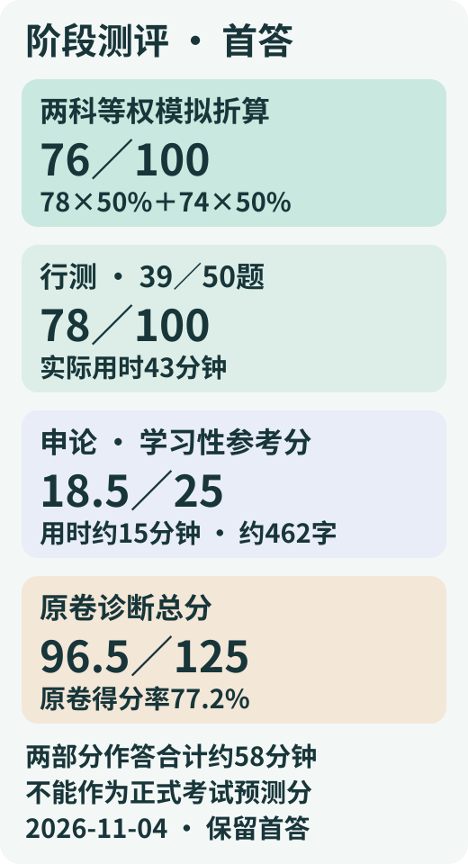

# 江苏A类阶段测评｜首答结果与批改

[本人完整首答](/daily-quizzes/2026-11-04-jiangsu-a-assessment-answer) · [原试卷](/daily-quizzes/2026-11-04-jiangsu-a-assessment) · [12题行测复盘](/cuotiben/江苏A类阶段测评复盘-2026-11-04)

| 项目 | 结果 | 真实用时 |
|---|---|---|
| 行测 | <strong>39／50题，78／100分</strong> | <strong>43分钟</strong> |
| 申论小题 | <strong>18.5／25分</strong>，学习性参考分 | 约15分钟（后续自报） |
| 本卷诊断合计 | <strong>96.5／125分（77.2%）</strong> | 约58分钟（两部分相加） |

<strong>这份申论找到了五个方面，第3、4条也写出了明确作用。</strong>主要失分是第1、2条措施较长而作用概括不足，第5条将材料里的过去问题写进措施，又漏掉新的评价和反馈机制。

## 行测表现

| 模块 | 答对／题数 | 本卷得分 |
|---|---:|---:|
| 政治理论 | 5／5 | 10／10 |
| 常识判断 | 4／5 | 8／10 |
| 言语理解与表达 | 11／12 | 22／24 |
| 数量关系 | 3／7 | 6／14 |
| 判断推理 | 11／13 | 22／26 |
| 资料分析 | 5／8 | 10／16 |

本卷失分集中在数量关系（4错）和资料分析（3错）；言语11／12、判断11／13。43分钟内完成50题；单题用时未知，不能据此判断哪一题慢，也不把这些结果直接当作正式考试能力排名。

<strong>错题：7、11、24、25、26、27、34、42、45、47、50。</strong>不确定：25、26、43，其中43答对；仍保留不确定状态。

### 全部题目核分

| 题号 | 本人首答 | 参考答案 | 结果 |
|---:|---|---|---|
| 1 | D | D | 答对 |
| 2 | B | B | 答对 |
| 3 | D | D | 答对 |
| 4 | B | B | 答对 |
| 5 | D | D | 答对 |
| 6 | A | A | 答对 |
| 7 | C | B | 答错 |
| 8 | C | C | 答对 |
| 9 | D | D | 答对 |
| 10 | C | C | 答对 |
| 11 | D | C | 答错 |
| 12 | C | C | 答对 |
| 13 | B | B | 答对 |
| 14 | A | A | 答对 |
| 15 | C | C | 答对 |
| 16 | A | A | 答对 |
| 17 | D | D | 答对 |
| 18 | A | A | 答对 |
| 19 | C | C | 答对 |
| 20 | A | A | 答对 |
| 21 | D | D | 答对 |
| 22 | A | A | 答对 |
| 23 | B | B | 答对 |
| 24 | C | D | 答错 |
| 25 | D | A | 答错 · 不确定 |
| 26 | A | D | 答错 · 不确定 |
| 27 | A | C | 答错 |
| 28 | A | A | 答对 |
| 29 | B | B | 答对 |
| 30 | C | C | 答对 |
| 31 | C | C | 答对 |
| 32 | B | B | 答对 |
| 33 | C | C | 答对 |
| 34 | C | A | 答错 |
| 35 | D | D | 答对 |
| 36 | B | B | 答对 |
| 37 | C | C | 答对 |
| 38 | D | D | 答对 |
| 39 | B | B | 答对 |
| 40 | C | C | 答对 |
| 41 | D | D | 答对 |
| 42 | C | D | 答错 |
| 43 | B | B | 答对 · 不确定 |
| 44 | B | B | 答对 |
| 45 | C | A | 答错 |
| 46 | C | C | 答对 |
| 47 | A | B | 答错 |
| 48 | B | B | 答对 |
| 49 | D | D | 答对 |
| 50 | C | B | 答错 |

### 全卷简明解析

错题及不确定题的完整题干、选项、数据表和解法见上方12题复盘。其余题目保留简析：

<strong>第1题：D。</strong> 结合禀赋以科技创新推动传统产业升级，同时培育新产业；不把新质生产力等同于产业名称新。

<strong>第2题：B。</strong> 科技攻关对应创新，公共服务普惠延伸对应共享，跨境贸易对应开放，循环利用对应绿色。

<strong>第3题：D。</strong> 坚持问题导向，兼顾不同类型与未受益群体，核验真实执行情况。

<strong>第4题：B。</strong> 政府提供规则、保护和共性服务，企业自主经营，体现有效市场与有为政府结合。

<strong>第5题：D。</strong> 以国内大循环为主体、国内国际双循环相互促进，不是封闭循环或地方小循环。

<strong>第6题：A。</strong> 水蒸气接触较冷皮肤液化放热；其余分别混淆凝结、导热和沸点变化。

<strong>第8题：C。</strong> 水的沸点受外界气压影响；气压下降通常使沸点下降。

<strong>第9题：D。</strong> 行政处罚法第二十九条：同一违法行为不重复罚款；违反多个规范应罚款时按罚款数额高的规定。

<strong>第10题：C。</strong> 按具体功能和必要程度处理数据，不能因概括同意无限扩张收集范围。

<strong>第12题：C。</strong> 前文否定把相关当因果；后文否定以模型替代调查与判断。

<strong>第13题：B。</strong> 第二类是停留原处拒绝尝试；不能因风险而废弃必要应用，固步自封、因噎废食最贴切。

<strong>第14题：A。</strong> 目录不是转化过程，核心是资源的解释、场景识别与表达加工。

<strong>第15题：C。</strong> 论述反对只按短期收入排序，要求兼顾长期探索；未否定应用研究或评价。

<strong>第16题：A。</strong> 题干强调不要唯名称，其他项均增添绝对化或因果结论。

<strong>第17题：D。</strong> 问题落在后台标准和更新责任，后文应承接解决机制。

<strong>第18题：A。</strong> ③提出现象，④解释错位，①指代并说明结果，⑤提升认识，②给出对策。

<strong>第19题：C。</strong> 共同目标与具体条件兼容，不能取消共同底线或排除地方适配。

<strong>第20题：A。</strong> 600×70%=420，过半即超过210；不能把条件比例当总体过半。

<strong>第21题：D。</strong> 同时保留内核与适应新需求，标题须覆盖两个方面。

<strong>第22题：A。</strong> D结构完整搭配恰当；A围绕与以…为中心句式杂糅，B缺主语，C加快与质量搭配不当。

<strong>第23题：B。</strong> 相邻差为4、9、16、25、36，即连续平方数，56+36=92。

<strong>第28题：A。</strong> (30+2x)(20+2x)-600=216，正根x=2；四周外扩两倍宽。

<strong>第29题：B。</strong> 并集52，参加项次数84，多计32；至少两项24，因此三项8，恰两项16。

<strong>第30题：C。</strong> 各行对应位置相同的黑格抵消，其他黑格保留，即逐格异或；C符合。

<strong>第31题：C。</strong> 相对面A-C、B-F、D-E；只有A、D、F不含相对面，可以共顶点。

<strong>第32题：B。</strong> ①③⑥均有2个相互分离的连接部分，②④⑤均有3个。

<strong>第33题：C。</strong> 水银与汞是同物异名，干冰是固态二氧化碳；小苏打是碳酸氢钠。

<strong>第35题：D。</strong> 实施首项动作，去除第二项所示对象，实现第三项目的；疏浚去淤泥以通航。

<strong>第36题：B。</strong> B系统检查自动决策结果差异并追因，符合定义；其余未针对决策偏差。

<strong>第37题：C。</strong> 已付不可收回报名费使其继续无价值行动；D违约金是未来可避免成本，不是已沉没成本。

<strong>第38题：D。</strong> 原始数据不变，仅空间汇总尺度变更导致结论不同，B完整符合。

<strong>第39题：B。</strong> 满足条件的组合仅乙丁、丙丁，丁必参加，甲必不参加。

<strong>第40题：C。</strong> B排除白天办事平移并直接验证原无法前来群体获得服务，与论点对应。

<strong>第41题：D。</strong> C提供同时发生、直接降低城区车流的其他主要原因，削弱归因。

<strong>第44题：B。</strong> (232-103.5)/(506-230)=128.5/276，约46.6%。

<strong>第46题：C。</strong> 2025各季230、276、322、352，前季310；环比约-25.8%、20%、16.7%、9.3%，第二季度最高。

<strong>第48题：B。</strong> 各园区平均产值依次为5、4.5、5、6亿元/家，丁最高。

<strong>第49题：D。</strong> 甲增量420-350=70，总增量160，70/160=43.75%。

## 申论逐项评分

请根据给定资料，概括S市推动公共文化服务从“有场馆”向“有服务”转变的主要措施，并说明其提升服务效能的作用。（25分）

要求：全面、准确、有条理；措施与作用对应清楚；不超过450字，建议写300—450字。

<strong>沿用出卷前固定口径：</strong>五组各4分（措施2＋作用2）共20分，条理3分，表达与字数2分。以下点值为学习性参考，不是官方细则或老师实评分。已写内容和同义表达给分，跨栏照计，不重复扣同一缺陷。

| 方面 | 措施／2 | 作用／2 | 小计／4 | 判分依据 |
|---|---:|---:|---:|---|
| 精准需求与错时供给 | 2 | 1 | 3 | 调研、分群体和错时供给均写到；按居民作息调整体现一定匹配作用，给部分作用分。未明确提炼提高匹配度、可及性。 |
| 联盟共享与基本服务保障 | 2 | 0.5 | 2.5 | 联盟、资源目录、预约、讲师排期和错时开放均写到。第5条“保留必要的公益保障”跨栏计入保障作用0.5分；减少重复采购、提高利用率未写。 |
| 本土内容与居民共创 | 1.5 | 2 | 3.5 | 共创、预约空间已写；“一次性观众”变为设计者和持续使用者，作用完整给分。本土文化与生活需求、体验—展示—持续创作的措施链条概括不足。 |
| 预约贯通与线下包容 | 1.5 | 2 | 3.5 | 统一入口、标准、责任、回流和线下代办已写；便利查询、避免余位错配已明确，作用完整给分。缺少最小范围采集信息、不附加授权门槛。 |
| 责任清单与效果评价反馈 | 1 | 1 | 2 | 责任清单和追溯作用给分；开头数量、场次、点击量和拆分课程属于过去问题，不计作提质措施。缺实际使用、持续参与等评价及公开反馈、联动后续配置。 |

<strong>内容14.5／20＋条理3／3＋表达与字数1／2＝18.5／25。</strong>五条顺序清楚，条理给满分；部分长句、第二条末尾逗号接下一条以及略超字数，在表达与字数项目合计扣1分，内容不再据此扣分。约462字比450字上限多约12字；不采用“超过450字后全部不看”的截断方式，此处也不冒充官方超字数扣分标准。

### 原答中应当保留的内容

第3条写出参与者从“一次性观众”成为设计者、持续使用者，已经回答“作用”；第4条写出单入口查询和避免线上线下余位错配，也应给足作用分。第5条末尾的公益保障已经跨栏计分，不判全漏。

### 最需要改的第5条

原答“统计建成数量、活动场次、页面点击量……将连续课程拆成许多小活动”是材料描述的<strong>过去问题</strong>。题目问提质行动的主要措施，应转到“改变按数量评价，重实际使用和持续参与，并把反馈接到下一季度安排”。这部分不计措施分，不再另设负分。

<strong>助手修改示范：</strong>建立责任清单，明确各环节承接单位；以实际到场、持续参与、需求回应和群众反馈评价，公开调整结果并衔接下期安排，兼顾特殊群体公益保障，提高服务实效和资源配置针对性。

### 两种参考作答

以下均由助手依据本题材料撰写；分别借鉴小马哥的分类概括方式、白鹭的措施与作用对应方式，不是两位老师的原答案。只用来对照，不计作本人改写或能力提升。

<strong>分类概括版：</strong>

一、精准识别需求。结合线上问卷、入户访谈和班组座谈，按群体、时段、交通条件调整清单，错时开课，提高服务匹配度和可及性。二、统筹共享资源。建立联盟、目录和预约规则，调配场地师资课程，错时开放学校空间，减少重复采购，提高利用率，保留偏远地区基本服务。三、推动居民共创。结合本地文化与生活需求共同设计课程，衔接体验、展示、持续创作和空间预约，促进居民持续参与。四、贯通线上线下。统一预约数据与更新责任，实现余位同步和取消回流，保留电话现场代办，按需最少收集信息，降低使用门槛。五、完善责任评价。明确各环节承接单位，以实际使用、持续参与和需求回应评价，兼顾特殊群体公益保障，公开反馈并联动后续安排，促使经费资源服务于真实需求。

<strong>措施—作用对应版：</strong>

1.完善需求识别和供给：结合线上意见、入户和班组访谈，按群体、时段及交通条件调整清单、错时开课，增强供需匹配和服务可及性。2.统筹共享资源：建立联盟、目录和预约规则，协调师资设备课程，错时开放空间，减少重复投入、提高利用率，并保留偏远地区基本服务。3.丰富共创内容：结合本地文化和生活需求，与居民共同设计体验、展示、后续创作活动，提供持续预约，推动被动观看转为长期参与。4.优化预约体验：统一入口、标准和更新责任，余位同步、取消回流，保留电话现场代办，最少采集信息，便利使用、减少门槛和资源空置。5.建立责任评价闭环：明确承接单位，以实际到场、持续参与、需求回应和群众反馈评价，兼顾特殊群体公益保障，公开结果并衔接下期课程、时段和资源，提高服务实效。

## 与历年江苏A类分数线如何比较

| 年度 | A类公共科目最低合格总分 | 行测最低合格分 | 来源 |
|---|---:|---:|---|
| 2024 | 110 | 50 | [省公务员局公告（建湖政府转载）](https://www.jianhu.gov.cn/art/2024/1/14/art_32128_4134686.html) |
| 2025 | 110 | 50 | [省公务员局分数线（江宁政府转载）](https://www.jiangning.gov.cn/hdjl/rdwthb/jy/202501/t20250117_5059002.html) |
| 2026 | 110 | 50 | [省公务员局公告](https://www.jszzb.gov.cn/tzgg/art/2026/art_d516cea604fdb1a1ff422b5455d52553.html) |

以上是正式两科考试的最低资格门槛。苏州2026年度按职位、拟录用人数3∶1，从笔试合格人员中按成绩择优确定面试人选，另有资格复审和递补，见[苏州市官方面试公告](https://www.suzhou.gov.cn/szsrmzf/mszx/202603/1236e9c12b9b455b9f7384a5b657b153.shtml)。统一A卷并不对应统一的苏州进面分数线。

<strong>本次能判断的位置：</strong>在本卷中，言语、判断的正确率高于数量与资料；申论已能分组提取措施，需要补全“措施→作用”和过去／现在的区分。<strong>不能判断真实苏州职位排名或进面概率</strong>：本卷为缩编自编题，缺少真题难度标定和考生分布，部分政治、言语题区分度有限；申论仅一小题，未测完整题型。不能将18.5乘4充当整科申论，不能将96.5按比例换算成正式200分总分，也不能凭本卷78分宣称实际已过行测线。

## 只做一个下一步

<strong>先把申论第5条独立重写成70—90字，覆盖“责任清单＋评价指标＋反馈联动＋作用”。</strong>提交后另记“本人改写”，保留本次首答18.5分；看过参考后的改写与未见解析的陌生题检验分别记录。

## 来源与状态

题目与固定评分框架：本聊天2026-11-04自编阶段测评。本人原答：《答案.docx》，提交于2026-11-04；原文件及原始文字在本地来源层保留，网站保留首答转录。外部分数线于2026-11-04重新核实。申论用时经用户后续补充为约15分钟；行测43分钟，两部分相加约58分钟。首次提交未填写用时的原始状态保留。实际作答起止、逐题思路和单题用时未知。独立迁移待验证，Obsidian云同步未验证。
