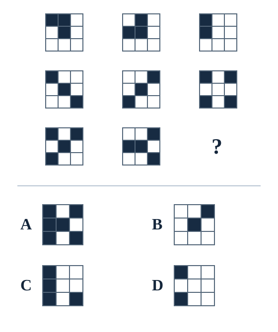

# 江苏A类风格阶段测评

**50道行测＋1道申论小题。建议行测45分钟，申论35分钟，共80分钟；可分两段完成，分别记录真实用时。**

本卷为参照江苏A类考试范围与常见题型编制的AI自编缩编卷，预计以中等难度为主，穿插中等偏难题；不是历年真题，也没有经过大样本难度标定。先闭卷作答，交卷后再给答案与解析。

**计分：行测每题2分，共100分；申论25分，本卷诊断总分125分。**交卷后给分项及综合诊断；本卷总分不直接与正式两科200分的合格线作数值比较，单道申论不直接代表整科申论成绩。

## 作答约定

- 不查资料、不使用计算器，卡住可标记后继续。行测每题只有一个最恰当答案。
- 保留首答；不确定或猜选的题号单独记下。未答用“—”占位，避免答案错位。
- 行测答卷结束即停表；申论另计时。若有中断，注明中断，不把聊天等待时间计入做题时间。
- 可以直接按“1—10：……；11—20：……”交卷，并附申论原答、两部分实际用时和不确定题号。


## 一、政治理论（第1—5题）

### 第1题

某地传统装备制造业基础较好，但部分企业能耗高、工艺落后。当地拟发展新质生产力。下列举措最符合因地制宜要求的是：

A. 将新增投资主要用于复制其他地区已形成规模的新兴产业园

B. 将传统产业企业统一迁出，以新注册企业数量衡量转型成效

C. 优先扩大已有生产线规模，待产量增长后再考虑创新投入

D. 围绕现有产业关键环节开展技术改造，同时培育有条件的新兴产业

### 第2题

某市围绕新发展理念安排年度工作：①支持基础研究和关键核心技术攻关；②推动基本公共服务更多向欠发达地区延伸；③完善跨境贸易便利化服务；④推动工业园区循环利用资源。以下对应正确的是：

A. ①协调、②创新、③开放、④共享

B. ①创新、②共享、③开放、④绿色

C. ①创新、②绿色、③协调、④开放

D. ①共享、②协调、③绿色、④创新

### 第3题

调研组拟了解某项惠民政策的实际落实情况。已有报告显示，示范点满意度较高，但偏远村镇投诉较多。下列调研安排最有利于形成可靠判断的是：

A. 扩大示范点参观规模，用更多示范点照片补充报告

B. 集中召开部门座谈会，以汇总材料替代基层走访

C. 按各地自报满意率排序，仅对排名靠前地区总结经验

D. 在不同类型村镇核对服务记录，直接听取受益者和未受益者意见

### 第4题

为促进产业创新，某地公开统一技术标准，完善知识产权保护，为企业提供共性技术服务，并让企业自主决定产品和投资方向。这主要体现了：

A. 以短期市场回报作为公共技术服务的唯一依据

B. 把有效市场和有为政府更好结合，营造创新环境

C. 通过扩大政府直接生产来解决所有市场风险

D. 以行政配置替代市场竞争来统一企业经营活动

### 第5题

关于构建新发展格局，下列理解最准确的是：

A. 将经济循环限于国内，逐步减少国际产业分工与合作

B. 各地区分别建立完整产业体系，尽量减少跨地区交换

C. 以扩大出口取代国内需求，形成主要由外需驱动的增长格局

D. 发挥国内超大规模市场优势，同时以高水平开放促进国内国际双循环

## 二、常识判断（第6—10题）

### 第6题

下列生活现象及其主要物理解释，对应正确的是：

A. 蒸汽烫伤有时比同温度热水更严重——水蒸气液化放热

B. 夏季冷饮杯外壁出现水珠——杯内水分子穿过杯壁

C. 冬天室外铁栏杆比木栏杆摸起来更冷——铁的温度必然更低

D. 高压锅使食物更易煮熟——增大气压使水的沸点降低

### 第7题

关于日食、月食及月相，下列说法正确的是：

A. 地球上处于夜间的所有地点都能看到同一次日全食

B. 日食只能发生在新月附近，但新月时未必发生日食

C. 月食发生时，月球位于太阳和地球之间

D. 每逢农历十五，地球都会遮住太阳照向月球的光

### 第8题

某实验室分别在低海拔和高海拔地区，用相同电热装置把相同质量的水加热至沸腾。忽略杂质和散热差异，下列判断正确的是：

A. 水一旦沸腾，继续加热会使水温持续显著上升

B. 相同质量的水，无论环境气压如何，沸点均相同

C. 高海拔地区气压较低，水通常在低于低海拔地区沸点的温度沸腾

D. 高海拔地区气压较低，因此沸腾时水温一定更高

### 第9题

某企业的同一个违法行为同时违反两项法律规范，依照两项规定均应给予罚款，且适用的罚款数额不同。依据《行政处罚法》，下列处理原则正确的是：

A. 分别依据两项规定作出处罚，再合并缴纳罚款

B. 按照罚款数额较低的规定处罚

C. 只要不同部门分别作出决定，就不受重复罚款限制

D. 不得给予两次以上罚款，按照罚款数额高的规定处罚

### 第10题

某应用提供公交到站时间查询。下列个人信息处理安排，最符合目的明确、直接相关和最小必要原则的是：

A. 为查询实时公交，必须上传全部通讯录和相册

B. 将同意提供精准定位作为使用所有功能的前提

C. 允许手动选择站点，需要附近站点时再由用户选择提供相应定位信息

D. 以用户已同意隐私政策为由，收集未来可能用到的一切信息

## 三、言语理解与表达（第11—22题）

### 第11题

城市更新既要改善居住条件，也要保留街巷肌理和公共记忆。如果把更新等同于对旧建筑的________，再用同一套商业模板覆盖不同街区，就容易使各具特色的城市空间变得________。依次填入画横线部分最恰当的一项是：

A. 循序渐进／独树一帜

B. 因地制宜／大同小异

C. 改头换面／千篇一律

D. 修旧如旧／如出一辙

### 第12题

算法能够识别变量之间稳定的联系，但不能因此将相关关系与因果关系________。面对公共政策问题，技术模型应为实地调查和专业判断提供辅助，而不应________它们。依次填入画横线部分最恰当的一项是：

A. 区分／修正

B. 衔接／证明

C. 混同／取代

D. 割裂／补充

### 第13题

面对层出不穷的新技术，有些机构未经需求论证便仓促采购，结果设备闲置。另一些机构则因担心试错而________，连已具备应用条件的项目也不愿尝试。技术应用需要积极探索并审慎评估，尤其不能因一次试点失败就拒绝所有已具备条件的应用，陷入________的困境。依次填入画横线部分最恰当的一项是：

A. 举棋不定／相提并论

B. 固步自封／因噎废食

C. 墨守成规／以偏概全

D. 望而却步／顾此失彼

### 第14题

一份地方文化资源目录可以记录文物、技艺、老字号的位置和数量，却不能自动形成有吸引力的文化产品。资源进入当代生活，还需要理解其历史含义，识别不同群体的使用场景，再选择合适的表达方式。缺少这些工作，即使把目录做得再完整，也可能只是把线下清单搬到了屏幕上。这段文字意在强调：

A. 文化资源要转化为可感知的内容，需要解释、场景和表达的进一步加工

B. 地方文化资源目录应优先提高统计数量的准确性

C. 数字技术会使传统文化资源失去原有历史意义

D. 只要文化产品有足够吸引力，就无需整理资源目录

### 第15题

评估科研工作的价值，既要看已经形成的应用成果，也应为探索性研究保留合理空间。某些基础研究的现实用途在短期内并不明确，但其提出的新概念、新方法可能成为后来突破的条件。如果所有研究都按当期收入排序，可能会奖励容易兑现的改进，却削弱未来创新所需的知识积累。这段文字主要说明：

A. 基础研究的价值只能在研究结束很多年以后被识别

B. 应用研究的短期收入越高，长期创新价值就越低

C. 科研评价应兼顾现实应用与长期知识积累，避免唯短期收益

D. 探索性研究不需要接受任何形式的效果评价

### 第16题

有些地方将制造业升级理解为不断引入新的产业名称，忽视原有企业的技术进步。事实上，产业是否先进，并不只取决于它被归入哪一目录，还取决于生产过程的技术含量、资源效率和组织能力。对传统产业进行数字化、绿色化改造，也可能形成新的竞争优势。对这段文字理解正确的是：

A. 判断产业升级不能只看产业名称，还应看实际生产能力的变化

B. 引入新兴产业必然妨碍传统企业技术进步

C. 传统产业与新兴产业不存在任何技术差别

D. 所有传统产业经过数字化改造后都会获得竞争优势

### 第17题

某地发现，办事平台访问量增长很快，群众反映的重复填表问题却未明显减少。进一步检查发现，多个部门虽然共用一个入口，后台仍各自维护同一类信息，更新口径也不一致。由此可见，增加入口功能并不必然解决信息流转中的堵点。接下来最可能讨论的是：

A. 群众应如何适应不同部门重复填表的要求

B. 如何设计更醒目的平台首页宣传标语

C. 互联网访问量统计的全部技术发展史

D. 如何统一后台数据标准及更新、共享责任

### 第18题

将下列句子重新排列，语序最恰当的一项是：

①这种错位，使得一些居民想用的设施不足，另一些设施却长期闲置。
②因此，配置设施前既要识别真实需求，也要检查居民能否在需要的时段使用。
③某些社区虽然公共设施总量增加，但居民的实际获得感没有同步提高。
④调查发现，设施种类与居民需求不匹配，开放时间也与居民作息冲突。
⑤问题并不只在“建了多少”，还在“建了什么、何时能用”。

A. ③④①⑤②

B. ④⑤③②①

C. ③①④②⑤

D. ⑤③①④②

### 第19题

统一标准可以降低跨地区合作成本，但标准的作用不是替各地写好全部实施细节。面对人口结构、自然条件和产业基础的差异，________。只有把共同目标与具体条件衔接起来，标准才能在实践中发挥作用。填入画横线部分最恰当的一句是：

A. 标准越详细，就越不需要了解地方情况

B. 应允许各地完全自行决定是否执行共同目标

C. 需要在共同底线之上，为具体实施保留因地制宜的空间

D. 只有取消统一标准，才能体现地区之间的差异

### 第20题

某项对社区老年居民的调查显示，在接受调查的600人中，七成表示愿意参加社区学习活动；在这七成人中，过半更偏好线下课程。调查还发现，有部分受访者愿意参加活动，但尚未确定课程类型。根据这段文字，可以确定的是：

A. 愿意参加活动的受访者中，偏好线下课程的人数超过210人

B. 偏好线上课程的人数必然等于600人的三成

C. 不愿参加活动的人一定不会使用线上学习资源

D. 600名受访者中过半更偏好线下课程

### 第21题

一种工艺若只被作为“过去的样子”收藏，可能逐渐与日常生活脱节。但如果为了迎合市场而抛弃其关键技法和文化含义，又可能使其失去辨识度。真正有生命力的传承，应在理解工艺内在规律的基础上，使材料、功能和表达适应新的生活需求。最适合作为这段文字标题的是：

A. 收藏是传统工艺获得生命力的唯一途径

B. 传统工艺应当全面恢复古代生活方式

C. 让市场需求决定传统工艺的全部价值

D. 传统工艺的传承：守住内核，回应当下

### 第22题

下列句子没有语病的一项是：

A. 相关部门梳理了群众集中反映的问题，并明确了整改责任和完成时限

B. 有关部门应加快信息系统的建设步伐和运行质量

C. 通过完善跨部门协作机制，使重复提交材料的现象明显减少

D. 各部门围绕以优化营商环境为中心，开展了专项整改

## 四、数量关系（第23—29题）

### 第23题

2，6，15，31，56，（　）

A. 86

B. 92

C. 97

D. 81

### 第24题

甲、乙两支施工队合作6天，完成一项工程的5/6；甲队单独工作4天，可完成该工程的1/3。两队效率均保持不变，乙队单独完成这项工程需要多少天？

A. 12天

B. 24天

C. 15天

D. 18天

### 第25题

一容器中装有浓度为30%的某溶液。先加入100克水并充分混合，再倒出此时混合液的1/5，最后加入80克浓度为10%的同种溶液，得到浓度为20%的溶液。忽略操作损失，原溶液质量是多少克？

A. 300

B. 200

C. 400

D. 240

### 第26题

甲、乙、丙、丁、戊5人等可能地排成一列。已知甲排在乙前面，且丙不在两端，则甲、乙相邻的概率是多少？

A. 2/5

B. 1/2

C. 1/4

D. 1/3

### 第27题

某饮品店昨日平均每杯利润为12元，今日总利润比昨日增加40%，销售杯数增加20%。今日顾客只购买两种套餐：甲套餐每份2杯、利润32元；乙套餐每份3杯、利润36元。每位顾客只买一份套餐，则今日购买甲、乙套餐的顾客人数之比为：

A. 1∶1

B. 4∶3

C. 3∶2

D. 2∶3

### 第28题

一块长30米、宽20米的长方形草坪，计划沿外侧四周修建等宽步道。步道面积为216平方米，则步道宽度为多少米？

A. 2

B. 4

C. 3

D. 1.5

### 第29题

60名员工参加三项培训，其中8人三项均未参加。参加第一、第二、第三项的分别为28人、30人、26人，至少参加两项的有24人。恰好参加两项的有多少人？

A. 24

B. 16

C. 8

D. 32

## 五、判断推理（第30—42题）

### 第30题

观察下图。每行第三个图与前两个图遵循相同规律，问号处应选择哪一项？



### 第31题

下图是一个正方体的展开图。下列哪组三个面，折叠后能够同时相交于同一个顶点？


A. A、B、C

B. B、D、F

C. A、D、F

D. C、D、E

### 第32题

把下列六个图形分成两组，使每组图形具有共同特征，分类最恰当的是：


A. ①②③／④⑤⑥

B. ①③⑥／②④⑤

C. ①④⑤／②③⑥

D. ①②⑥／③④⑤

### 第33题

水银：汞，与这组词的关系最相近的是：

A. 煤气：天然气

B. 小苏打：碳酸钠

C. 干冰：固态二氧化碳

D. 石灰石：生石灰

### 第34题

蚕丝：蚕茧：丝绸，与这组词的关系最相近的是：

A. 纸浆：木材：纸张

B. 汽油：石油：燃料

C. 果汁：水果：果酱

D. 水泥：砂石：混凝土

### 第35题

过滤：杂质：净化，与这组词的关系最相近的是：

A. 压缩：文件：备份

B. 灌溉：水分：增产

C. 筛选：信息：汇总

D. 疏浚：淤泥：通航

### 第36题

算法审计是指对自动化决策系统的输入数据、处理规则或输出结果进行系统检查，以识别偏差、歧视或其他不当影响。根据上述定义，下列属于算法审计的是：

A. 平台公布本月累计处理业务件数和服务器运行时长

B. 工作人员抽取条件相同而属性不同的样本，比较系统给出的审批结果并追查差异原因

C. 研究者访谈用户对软件界面配色的偏好，不接触其自动决策过程

D. 开发团队为提高页面打开速度，压缩图片和字体文件

### 第37题

沉没成本效应，是指人们因已经付出且无法收回的时间、金钱等成本，而继续选择原本不值得继续的行动。根据上述定义，下列最符合沉没成本效应的是：

A. 某企业考虑未来设备维护费用，选择维修成本较低的机型

B. 某公司考虑终止合同需要支付的违约金，重新比较继续履约与终止的成本

C. 某人判断一门课程已无学习价值，却因报名费不能退还而继续耗时听课

D. 某人发现新项目风险较高，决定先用小额资金进行试验

### 第38题

统计分析中的空间汇总效应，是指原始观测对象和数据不变，仅因空间汇总单元的划分方式或尺度变化，分析结论随之改变。根据上述定义，下列属于空间汇总效应的是：

A. 同一行政区采用相同方法调查，三年后就业率明显上升

B. 将地图颜色由蓝色改成绿色，但各地区数值和分析结论均不变

C. 增加调查样本后，估计出的居民收入均值发生变化

D. 用同一批家庭数据，分别按街道和区县汇总后，所得两项指标的相关程度不同

### 第39题

甲、乙、丙、丁四人中，恰有两人参加某项目。已知：甲参加，则乙不参加；乙、丙至少一人参加；丙参加，则丁参加；甲、丁不能同时参加。由此可以推出：

A. 丙一定参加

B. 丁一定参加

C. 乙一定参加

D. 甲一定参加

### 第40题

某市开设晚间政务服务窗口后，窗口办理总人次增加。有关人员据此认为，晚间窗口提高了原先因工作时间冲突而无法办事群体的服务可及性。下列哪项如果为真，最能支持这一判断？

A. 晚间窗口工作人员对新排班方案的熟悉程度逐渐提高

B. 周边城市也在讨论延长政务服务时间

C. 当月白天窗口人次没有下降，夜间新增办事者大多此前无法在白天前来

D. 晚间窗口的宣传材料使用了更醒目的版式

### 第41题

某城区修建自行车道后，监测显示其早高峰机动车平均通行速度有所提高。研究者认为，主要是自行车道吸引部分居民放弃开车，从而减轻拥堵。下列哪项如果为真，最能削弱这一解释？

A. 监测设备在修建自行车道前后保持相同统计口径

B. 部分原本步行的居民开始使用共享自行车

C. 自行车道使用者认为骑行环境比以前更舒适

D. 自行车道开放同期，一条过境道路分流了大量原本经过城区的机动车

### 第42题

某市试点发现，审核纸质材料平均每件需12分钟，审核电子材料平均每件需8分钟。由此，有人预计全面改用电子材料后，每件业务从提交到办结的平均总时长会缩短。该推断成立所必需的前提是：

A. 纸质材料在任何业务中都比电子材料更难辨认

B. 所有办事群众都能够独立完成电子材料制作

C. 全面电子化后无需保留任何人工核验环节

D. 电子化新增环节或其他环节的平均耗时增加，不会完全抵消审核节省的时间

## 六、资料分析（第43—50题）

### 资料一（第43—46题）

以下为某地区工业生产的模拟统计资料，仅用于本卷计算，所有累计口径一致。战略性新兴产业产值包含在工业总产值中。单位：亿元。

| 累计时期 | 2024年工业总产值 | 2024年战略性新兴产业产值 | 2025年工业总产值 | 2025年战略性新兴产业产值 |
|---|---:|---:|---:|---:|
| 一季度 | 200 | 80 | 230 | 103.5 |
| 上半年 | 440 | 176 | 506 | 232 |
| 前三季度 | 690 | 276 | 828 | 372 |
| 全年 | 1000 | 400 | 1180 | 531 |

### 第43题

2025年第三季度，该地区工业总产值比上年同期增长约：

A. 36.0%

B. 28.8%

C. 20.0%

D. 16.7%

### 第44题

2025年第二季度，该地区战略性新兴产业产值占同期工业总产值的比重约为：

A. 40.0%

B. 46.6%

C. 45.0%

D. 50.0%

### 第45题

2025年全年，该地区战略性新兴产业产值的同比增量，占工业总产值同比增量的比重约为：

A. 72.8%

B. 45.0%

C. 65.5%

D. 55.0%

### 第46题

若把2024年第四季度作为2025年第一季度的上一季度，2025年该地区工业总产值环比增长率最高的是：

A. 第一季度

B. 第三季度

C. 第二季度

D. 第四季度

### 资料二（第47—50题）

以下为四个产业园区的模拟统计资料。各园区2024、2025年统计范围及企业数口径可比，产值单位为亿元；企业数为2025年纳入统计的企业数。

| 园区 | 2025年产值 | 比2024年增长 | 2025年企业数（家） |
|---|---:|---:|---:|
| 甲 | 420 | 20% | 84 |
| 乙 | 360 | 12.5% | 80 |
| 丙 | 300 | 25% | 60 |
| 丁 | 240 | -4% | 40 |

### 第47题

2025年，四个园区合计产值比上年增长约：

A. 12.5%

B. 13.8%

C. 16.0%

D. 13.4%

### 第48题

2025年，平均每家企业产值最高的园区是：

A. 乙

B. 丁

C. 丙

D. 甲

### 第49题

甲园区的产值同比增量，占四个园区产值同比增量之和的比重约为：

A. 50.0%

B. 31.8%

C. 25.0%

D. 43.8%

### 第50题

根据资料，下列判断正确的是：

A. 2024年甲、丙两园区产值之和不足四园区合计的50%

B. 2025年丁园区平均每家企业产值比丙园区高20%

C. 2025年四园区合计产值增长率等于四个园区增长率的简单平均数

D. 2025年乙园区产值占四园区合计的比重比上年上升

## 七、申论（25分）

本题给定资料为自编模拟情境，不对应真实地区的事实调查。

### 给定资料

**资料1**

S市近年新建、改造了一批公共文化场馆，基本实现了街镇服务设施覆盖。但一次走访发现，有的场馆周末活动报名很热闹，平日却少有人来；一些新建场馆与居民常去的活动空间相距较远。社区工作者说：“不能用地图上有多少个点，就判断居民得到了多少服务。”市里决定开展公共文化服务提质行动。

起初，部分街镇主要依据线上问卷制定活动计划。问卷反馈多来自经常使用手机的年轻人，一些老年居民、夜班工人和带幼儿家庭的需求没有充分体现。后来，街镇将入户访谈、企业班组座谈与线上意见结合，区分不同人群的内容偏好、可参与时段和交通条件，按季度调整活动清单。工业园周边文化站增加了晚间和周末场次，社区活动点根据居民作息安排短时课程。

**资料2**

文化馆工作人员发现，某些场馆缺师资，另一些单位虽有教师和设备，却缺少组织活动的场地。市里组织文化馆、图书馆、高校和社会文化机构建立服务联盟，梳理可共享的场地、师资与课程，统一发布目录。成员单位按照预约规则提供资源，跨街镇流动的讲师由联盟协调排期，不再要求每个站点都独立购置同类设备。学校阅读空间在确保教学和安全管理的前提下，按公布时段向社区开放。

一位基层负责人说：“以前为了让每个点都齐全，经费常用来重复采购；现在把资源送到真正缺的地方，已有设备的使用率也提高了。”市里同时保留了交通不便地区的基本服务点，避免把共享简单理解为撤并场馆。

**资料3**

在课程设计上，一些场馆过去常把成熟节目原样送下去，居民只是坐着看。提质行动邀请非遗传承人、社区教师与居民共同设计活动。例如，围绕本地传统印染技艺，先听居民讲述家庭记忆，再安排基础操作、作品展示和后续小组创作；有居民提出希望把图样用于日常用品，教师便增加了相应的设计环节。课程结束后，学员可以继续预约公共制作空间。参与者从一次性观众逐渐成为活动设计者和持续使用者。

**资料4**

多家场馆曾分别开发预约入口，课程名称、余位和取消规则不一致，居民常在多个页面间反复查询。市里整合预约服务，统一基本数据标准和更新责任，使居民能在一个入口查询可预约资源，临时取消的名额及时回流。工作人员提醒，平台不是把页面链接集中起来就算建成，还要确保后台信息同步。

对不便使用智能设备的人群，场馆保留电话和现场登记，由工作人员帮助查询、办理；不同渠道使用同一资源余位信息，避免线上约满、现场却有空位的情况。市里还要求按实现预约所需的最小范围收集信息，不把额外授权作为基本服务的门槛。

**资料5**

过去，部门分别统计建成数量、活动场次、页面点击量，基层为了多报场次，有时将连续课程拆成许多小活动。提质行动建立统一的服务事项和责任清单，明确资源发布、活动组织、现场保障、投诉处理等环节的承接单位，问题能够追溯到具体责任环节。

评价不再只看“办了几场”，还结合实际到场、持续参与、需求回应和群众反馈，检查服务是否真正可用。对覆盖偏远居民、服务特殊群体但人数较少的活动，保留必要的公益保障，不简单按人次削减。各场馆定期公开调整结果，把收集到的意见与下一季度课程、时段和资源安排衔接起来，推动经费和资源向实际服务需要倾斜。

### 作答任务

请根据给定资料，概括S市推动公共文化服务从“有场馆”向“有服务”转变的主要措施，并说明其提升服务效能的作用。（25分）

要求：全面、准确、有条理；措施与作用对应清楚；不超过450字，建议写300—450字。

## 交卷格式

```text
1—10：
11—20：
21—30：
31—40：
41—50：

行测实际用时：
申论实际用时：
不确定／猜选题号：
中断或其他作答说明：

申论原答：
```

先保留原答，交卷后再批改。
