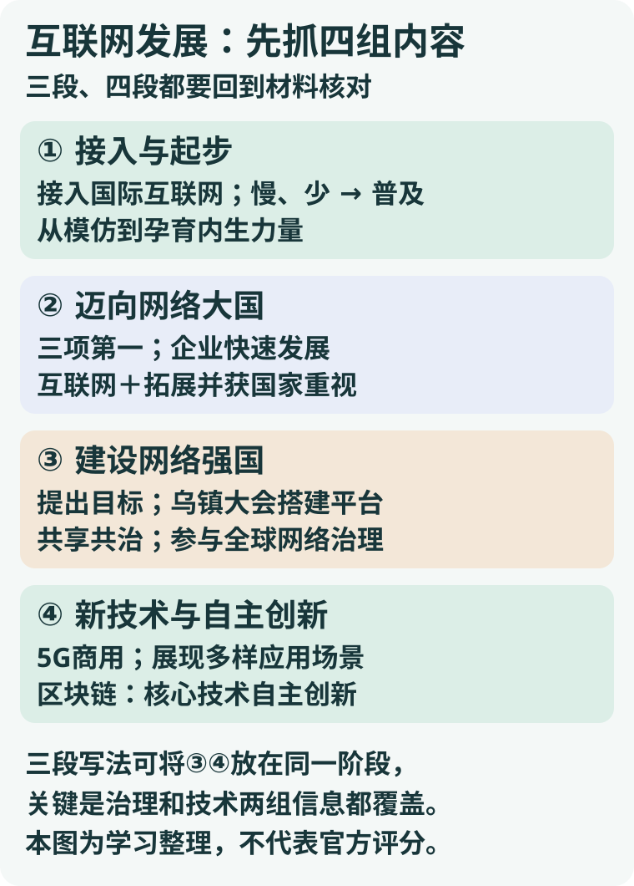

<section class="quiz-shenlun">

# 互联网发展阶段｜多平台答案对照

**先覆盖材料的四组信息：起步、迈向网络大国、建设网络强国、技术与自主创新。三段或四段都可组织这些内容；分段数量本身不是已证实的官方评分规则。**

<a class="compact-flow-link" href="/xuexi-notes/compact-flow-20261109/aligned-ef822d43563e1d64892c.svg" target="_blank" rel="noopener"><picture class="compact-flow"><source srcset="/compact-flow-20261109/aligned-ef822d43563e1d64892c.svg"></picture></a>

<a href="/xuexi-notes/compact-flow-20261109/aligned-ef822d43563e1d64892c.svg" target="_blank" rel="noopener">放大查看图解</a>

[查看原尺寸对照图](/daily-quizzes/assets/2026-11-06-申论阶段对比.svg)

[原题与资料](/daily-quizzes/2026-11-06) · [本人首答](/daily-quizzes/2026-11-06-answer) · [原学习性结果](/daily-quizzes/2026-11-06-review)

题目为2020年江苏省考申论A卷第一题，20分，不超过250字；资料截至2019年。 **用户已明确：答案以OK公考讲义为主要依据，其他平台仅辅助比较并回到材料核对。**下列均是讲义或机构参考，并非已核实的官方标准答案。网页之间是否相互借鉴无法完全确认，不能简单按页面数量视为独立证据。

## 查到的版本：谁怎样分

| 来源与可核实范围 | 分段 | 值得注意的差别 |
|---|---|---|
| 用户提供的OK公考讲义DAY12，PDF第76—81页，其中参考成稿在PDF第81页（印刷第79页） | 四组：加入互联网、迈向大国、建设强国、自主创新 | 保留整体发展线索；成稿最后一组强调大数据、媒体融合、区块链和方向引领。讲义逐段解析在PDF第80页提到5G与万物互联，但最终参考成稿没有单独列出5G。 |
| [午后书真题：该题参考要点](https://iget100.wuhoushu.com/gongkao/shengkao/jiangsu/2020/shenlun-a) | 四组：起步、网络大国、网络强国、5G商用 | 第四组明确写5G及万物互联，并把核心技术和产业创新纳入；页面显示参考要点，原作者及与其他讲义的关系未确认。 |
| [公考通真题答案册](https://www.chinagwy.org/files/20191209102423_45540.pdf) | 四组：起步、发展、壮大、创新引领 | 末组强调5G商用、互动体验和区块链产业创新；第二组还概括企业家责任和国家重视。PDF页眉标注公考通网址。 |
| [公考通系统班答案，经典真题6](https://gwyapp-files.oss-cn-shanghai.aliyuncs.com/wangxiaofiles/2021%E9%9D%9E%E5%85%AC%E5%BC%80%E8%AF%BE/%E7%B3%BB%E7%BB%9F%E7%8F%AD%E7%AD%94%E6%A1%88%EF%BC%88%E8%A1%8C%E6%B5%8B%2B%E7%94%B3%E8%AE%BA%EF%BC%89.pdf) | **三组**：起步、网络大国、建设网络强国 | 将全球治理、5G及区块链放在第三组；后期治理内容写得更简洁。与上一行同属公考通材料，不计成两个独立平台。 |
| [唐面《江苏省考申论备考手册》存档](https://studylib.net/doc/27322438/2023%E5%B9%B4%E6%B1%9F%E8%8B%8F%E7%9C%81%E8%80%83%E7%94%B3%E8%AE%BA%E4%B8%93%E7%94%A8%E6%89%8B%E5%86%8C) | 四组：起步、迈向大国、建设强国、核心技术创新 | 第四组侧重新技术、新应用和新业态，参考成稿未具体列出5G、区块链。网页是手册存档，身份按文档署名记载，原始发布链未核实。 |

[拉西学习资源站的答案页](https://lasee.net/gongwuyuan/167763853610403.html)与公考通四阶段答案在结构与措辞上高度相似，故作为转载线索，不单独计算一个独立版本。也未找到可核实的本题粉笔完整答案；不把其他网站的答案标成粉笔。

## 回到材料：共同点与取舍

| 材料依据 | 可以提炼的特点 | 对照时需要保留的边界 |
|---|---|---|
| 1994年接入；拨号、网速慢、用户少；从模仿到孕育内生力量 | 起步接入、基础较弱，逐步普及并孕育自身力量 | 材料写“模仿”，未直接说“互联网壁垒较高”；不从“第77个接入”推断具体技术差距。 |
| 网民、宽带网民数量及CN域名三项世界第一；企业发展；互联网+教育、医疗等 | 规模壮大、企业发展，互联网+应用多元并受到国家重视 | CN域名的“第一”是**国家顶级域名注册量**，不扩大成全部域名均第一。 |
| 2014年提出网络强国目标；乌镇会议平台、倡议和展望，推动全球治理 | 面向网络强国建设，互联互通、共享共治并参与全球治理 | 重点是治理与国际合作，不要只留“2014”或“乌镇”名称。 |
| 2019年5G商用与博览会展示；区块链被提出为核心技术自主创新突破口 | 新技术商用及多样应用展示，重视核心技术与产业创新 | 博览会是展示，不直接推成所有技术已普及；“自主创新”有区块链原文支撑，不能仅凭5G商用就推断每项技术均自主研发。 |

各来源对核心信息有相近覆盖，但分组和详略有区别。用户讲义成稿没有单列5G，午后书与公考通版本列出；因此，“5G是否单独成段”和“是否写5G”不是一回事。

## 哪些表述要回到材料核对

- **关于“网络强国”**：材料说已成为网络大国、提出建设网络强国目标。写“建设网络强国”“向网络强国迈进”，比断言“已经建成网络强国”更贴材料。
- **关于“起步晚、网速快、竞争更激烈”**：有的参考答案用了这些概括。材料给出第77个联网国家、早期网速及后期竞争描述；这些判断涉及比较或推断，原文没有给出完整的横向起步比较、后期具体网速和竞争强弱的前后量化。考场可优先写材料直接支持的接入、网速慢、用户少、企业萌芽及后期竞争要求。
- **关于时间边界**：某手册按90年代末—2014、2014—2019及2019年至今划分；材料只提供到2019年，且互联网+和网络强国叙述有交叉。年份是辅助组织的线索，不把“至今”延伸成对当前互联网状况的判断，也不把年份切分当作唯一规则。
- **关于5G与自主**：5G商用及应用展示是一个材料事实；区块链与核心技术自主创新是另一个有明确文字依据的事实。可以合在技术创新组，但不能只凭5G商用断言全部5G技术自主领先。

## 和你的首答逐项对照

| 你的首答 | 已覆盖 | 按材料可补或修正 |
|---|---|---|
| 萌芽：模仿、用户少、速度缓慢 | 起步阶段部分信息已写；“速度”可明确为网速 | 补正式接入、由模仿到内生力量及逐渐普及；“壁垒较高”材料无直接依据。 |
| 发展：三项第一、企业发展、互联网+国家行动 | 这一组主要事实已写 | 可把多个互联网+领域归并为应用拓展；CN第一保留国家顶级域名的范围。 |
| 领先：5G进入、区块链成焦点 | 已写后期技术对象 | 明确5G商用、核心技术自主创新；还需补网络强国目标、乌镇平台及全球治理。不单凭5G使用就写“整体领先”。 |

你的第三组可以作为后期的合并结构，再分别写清**网络治理**和**技术创新**；也可以拆为两组。现有资料并未提供真实阅卷细则，不能保证哪种结构必得多少分。此前10.5/20是按本地预设“四组各5分”的学习性评分；其中“网络强国组0/5”只表示该组治理信息未覆盖，不表示你第三条的5G、区块链完全没写（它们已在技术组获得部分参考分）。原分与首答保留，分段不作独立扣分依据。

## 结合材料的参考整理

我国互联网从无到有、由弱到强：①起步：接入国际互联网，由模仿到孕育内生力量，网速慢、用户少，逐渐普及。②迈向网络大国：网民、宽带网民数量居世界首位，CN域名成为注册量最大的国家顶级域名；企业快速发展，互联网+拓展应用并上升为国家行动。③建设网络强国：搭建互联互通、共享共治平台，参与全球网络治理。④技术创新：5G进入商用，重视区块链等核心技术自主创新，推动产业创新与经济转型。

这是本次对照材料和讲义写成的学习参考，不是用户改写，也不是官方公布答案。材料中的CN域名范围在上文已明确；未知真实阅卷口径，不能保证分值。

## 这题怎样从例子找到特点

1. **先找材料总括句。**华图江苏分院用本题说明，材料首段的整体发展表述可用于归纳总线。[方法原文](https://www.huatu.com/2021/1201/2338360.html)
2. **再用节点划开信息。**1994接入、2008网络大国、2014强国目标、2019商用及创新是定位线索；最后按内容归并，不把它们当唯一切分标准。
3. **把案例上提一层，并回文核对。**教育、医疗、政务、文化→互联网+应用领域拓展；乌镇倡议、展望→共同推动全球治理；机械臂、手势、眼控→展示多样应用场景。每个概括都保留材料范围，不多推一步。

后续建议：先独立补写原答缺失的网络治理信息，再用同一题材料检查；这只是同题改写，陌生真题迁移另行验证，不自动改首答成绩。

</section>
