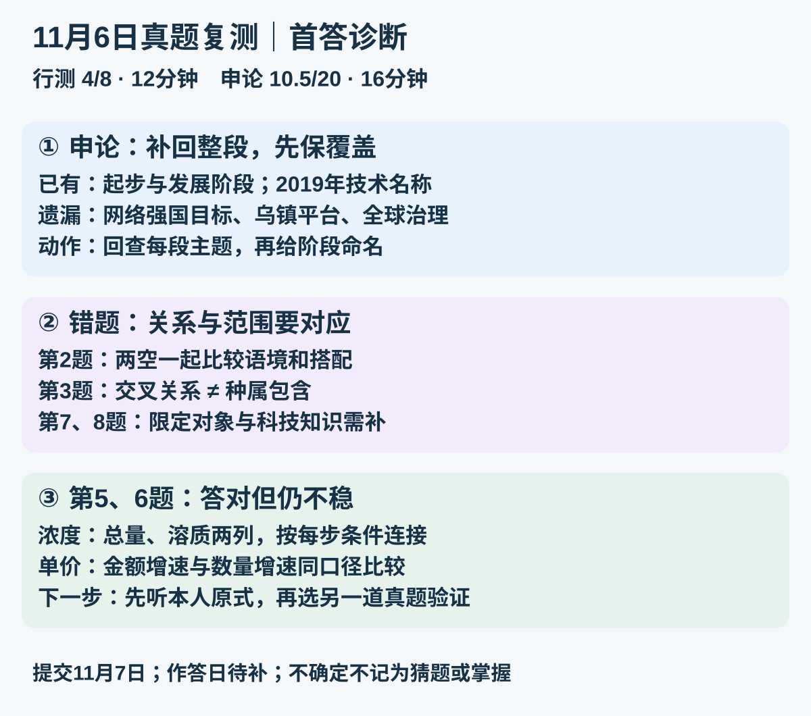
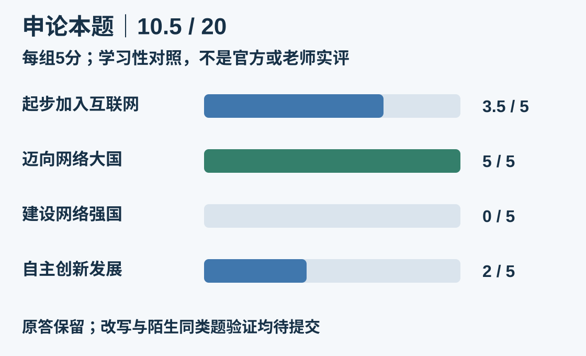

# 11月6日真题卷｜11月7日交卷批改

**行测4/8，12分钟；申论学习性参考10.5/20，16分钟；合计28分钟。** 第5、6题答对但本人不确定，保留为待验证；其他题的具体思路和单题用时未知。出题日、提交日与实际作答日分开，实际作答日期尚未单独确认。

[原试卷](/daily-quizzes/2026-11-06) · [本人首答](/daily-quizzes/2026-11-06-answer) · [六题原题与逐题复盘](/cuotiben/每日测验复盘-2026-11-06)

<a :href="quizResultImage" target="_blank" rel="noopener">放大查看图解</a>

## 逐题结果

| 题号 | 本人首答 | 参考 | 结果与记录 |
|---|---|---|---|
| 1 | D | D | 答对；把握度未单独报告 |
| 2 | C | B | 错题；两空词义与搭配 |
| 3 | D | A | 错题；交叉关系与种属关系 |
| 4 | A | A | 答对；把握度未单独报告 |
| 5 | A | A | 答对但不确定，原式待补 |
| 6 | D | D | 答对但不确定，原思路待补 |
| 7 | B | C | 错题；对象范围限定 |
| 8 | C | D | 错题；科技知识补充诊断 |

第1题围绕“光合细菌—代谢功能—医药应用”提取关键词。第4题A直接回应初诊者等待与就诊安排；人数不明显增多不保证各时段队列安排。答对仍需结合本人思路判断稳定性。

## 四道错题：先核对具体差别

| 题号 | 最终解析 | 易错提醒 |
|---|---|---|
| 2 | “名副其实”对应数据证明风向标名实相符；“映照出”搭配合适，选B | 不只凭第二空“折射”顺口定C |
| 3 | 本土／野生／名贵可交叉，A对应；D中的社区治理属于社会治理 | “都跟治理有关”不等于关系相同 |
| 7 | ②把“劳动者”扩大为“每个公民”，正确组合①③④，选C | 核对限定对象；原文已回查 |
| 8 | 图中热棒传走路基热量，保护冻土，选D | 不是动物围挡；未提供原思路，不反推错因 |

## 第5题：答对不确定，先连两列

参考A，100克。设两瓶原质量均为$m$克、浓度均为$c$。

| 甲瓶时点 | 溶液总质量 | 酒精质量 |
|---|---:|---:|
| 原来 | $m$ | $mc$ |
| 加20克水 | $m+20$ | $mc$ |
| 再加30克纯酒精 | $m+50$ | $mc+30$ |

恢复原浓度给出：

$$mc+30=c(m+50)\quad\Rightarrow\quad c=\frac{30}{50}=60\%$$

中间两瓶浓度相等，再连接两列：

$$\frac{0.6m}{m+20}=\frac{0.6m+50\times0.30}{m+50}$$

$$0.6m(m+50)=(0.6m+15)(m+20)\quad\Rightarrow\quad m=100\text{克}$$

代回：甲加水后$60/120=50\%$；乙加入溶液后$75/150=50\%$；甲再加纯酒精后$90/150=60\%$。两条件都满足。中间浓度不必先知道，也不能把加入50克溶液当成加入50克酒精。

## 第6题：答对不确定，比较两种增速

参考D。平均价格＝金额／数量，先固定产品、进出口方向和同一时期。

$$\frac{\text{本年单价}}{\text{上年单价}}=\frac{1+\text{金额增速}}{1+\text{数量增速}}$$

在本题数量与金额均为正的条件下，金额增速大于数量增速，单价上升。

| 产品方向 | 金额增速 | 数量增速 | 单价变化 |
|---|---:|---:|---|
| 柴油机出口 | 18.9% | 10.0% | 上升 |
| 柴油机进口 | 41.7% | **7.3%** | 上升 |
| 汽油机出口 | 3.4% | 6.3% | 下降 |
| 汽油机进口 | −28.5% | −28.2% | 下降 |

进口汽油机的−28.5%小于−28.2%，不能取绝对值后反过来比较。这里判断升降即可，无须逐个算出单价。表中柴油机进口数量增速按原图为7.3%。

<section class="quiz-shenlun">

## 申论：补回网络强国阶段，再提炼创新特点

**学习性参考分10.5/20。** 依据完整资料1及用户上传OK公考讲义DAY12参考答案，按出卷前保存的“四阶段各5分”口径展开；每组“阶段与特点概括2分＋主要信息3分”。这不是官方或老师给本人打分，不与旧题裸分直接比较趋势。

原答按去空白、含标点、保留数字序号计**154字符**，未超250字；不因短、名称不同、没有年份或没有总领句机械扣分。原答三个编号不等于必须判错，失分依据是信息覆盖。

| 对照组 | 已写信息与得分依据 | 得分 | 缺口 |
|---|---|---:|---|
| 起步加入互联网 | “萌芽阶段”及模仿、网速慢、用户少认可。合理归类2；信息1.5 | 3.5/5 | 正式接入信息0/1；从模仿到内生力量、逐渐普及只写模仿，0.5/1；网速和用户特征1/1 |
| 迈向网络大国 | 三项世界第一、企业发展、“互联网+”升为国家行动均已写；阶段名称不同不扣分 | 5/5 | 此组主干完整，可以压缩但不因抄写材料扣分 |
| 建设网络强国 | 原答未覆盖这一段 | 0/5 | 2014年目标、乌镇大会平台、互联互通／共享共治／全球治理 |
| 自主创新发展 | 2019年技术阶段辨识1/2；“5g进入”“区块链成为焦点”各按部分信息0.5 | 2/5 | 尚未提炼自主创新方向；5G商用／万物互联、区块链技术产业创新与转型作用未完整表达 |

**只按未覆盖的信息计缺口，不再因相同遗漏重复扣组织分。** “互联网壁垒较高”不是材料直接支持的阶段特点，本项不计分，也不额外倒扣。“领先”过于笼统，需用创新方向与作用落地；不只是把标题换成标准词。

### 老师参考与材料的对应

| 讲义参考组 | 资料依据 | 你当前原答 |
|---|---|---|
| 加入国际互联网 | 从无到有，模仿到内生力量并渐普及，网速慢、用户少 | 主干部分覆盖 |
| 迈向网络大国 | 三项第一，企业发展，互联网+应用与国家重视 | 信息较完整 |
| 建设网络强国 | 2014年目标、乌镇平台、全球治理贡献 | 整组遗漏 |
| 自主创新发展 | 5G与万物互联、区块链技术产业创新，引领转型 | 列了两个名词，特点与作用不足 |

讲义将“互联网+”列入第二组，但材料叙述跨年份；允许合理分期，不强求背年份边界。以上为讲义观点与本次学习性对照。

### 参考整理稿（189字符）

我国互联网从无到有、由弱到强。①起步：接入国际互联网，由模仿到孕育内生力量并逐渐普及，拨号上网、网速慢、用户少。②网络大国：网民、宽带网民、CN域名注册量三项世界第一，企业飞速发展，“互联网+”融入多领域并上升为国家行动。③网络强国：提出建设目标，举办乌镇大会，推动互联互通、共享共治和全球治理。④自主创新：5G商用、万物互联，推进区块链等技术产业创新，引领产业变革和经济转型。

此稿由AI依据材料及指定讲义整理，不覆盖本人首答，不记本人完成改写或独立掌握。

</section>

## 今天先做什么

已完成本卷28分钟，其他任务和剩余时间未知，不追加整套练习。

| 有多少余力 | 只做这一小步 | 建议时间 | 完成标准 |
|---|---|---:|---|
| 约5分钟 | 给申论补一条“建设网络强国”，再检查每段是否被覆盖 | 5分钟 | 有目标、平台与治理方向；不只写时间或名称 |
| 还有约5分钟 | 补第5题原式、第6题当时比较的两列 | 再5分钟 | 能说出每个数来自哪个时点、哪一列；先保留本人方法 |
| 没有余力 | 今天到此，等正常卷验证 | 不加任务 | 不形成未做补债 |

这些只是建议，未记执行。16分钟仅为本次自报用时，不据此推断单题耗时或错因。

## 后续真题复测与来源

约11月9日、11月14日，优先将**类比关系、浓度／平均数不确定点、申论阶段覆盖**嵌入正常日卷。选同考点另一道完整未做真题，保留首答与真实用时；数量和资料如遇同日题型额度冲突，择近正常卷安排，不加第二份卷，不积补债。目前均未执行。

来源：11月6日完整原卷、11月7日本人首答及用时补充、OK公考公开课PDF第76—81页（资料与老师参考），预存评分框架。第7、8题按下列权威原文当日复核。

- [高质量充分就业原文](https://www.miit.gov.cn/xwfb/szyw/art/2024/art_86d2fba2f920400097b265ccc2adfd2d.html)。
- [中国科学技术馆：热棒原理](https://www.cdstm.cn/museum/zphc/ggkfssznz/art/2018/art_110db7a3f34344ae9c938d9da0c3a850.html)。

[每日入口](/daily-quizzes/)。本地保存、网站发布与实际验看分别核对；Obsidian云同步未验证，不继续配置。
