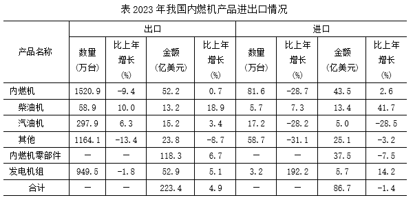

# 11月6日｜公考真题复测

**8道行测＋1道申论，建议30—40分钟，闭卷作答。** 行测为2025年江苏省考A类网友回忆版原题，申论为2020年江苏省考A卷原题。题干、选项、必要原图和申论资料完整保留，只调整排版。第7、8题及申论本次具体任务作补充诊断，不预设已经学过。

记录真实用时及不会、猜测、犹豫的题；遇到以前做过或看过解析的原题，请注明。旧卷未答不补债。

[每日入口](/daily-quizzes/) · [结果报告（等待交卷）](/daily-quizzes/2026-11-06-review)

## 第1题

来源：2025年江苏省考《行测》A类，原第34题（网友回忆版）。[题源](https://raw.githubusercontent.com/ERRRC/xingcezhenti/278984401124db40da5163a31275b8deb9c282f4/03-%E8%A8%80%E8%AF%AD%E7%90%86%E8%A7%A3%E4%B8%8E%E8%A1%A8%E8%BE%BE/2025%E5%B9%B4%E6%B1%9F%E8%8B%8F%E7%9C%81%E5%85%AC%E5%8A%A1%E5%91%98%E5%BD%95%E7%94%A8%E8%80%83%E8%AF%95%E3%80%8A%E8%A1%8C%E6%B5%8B%E3%80%8B%E9%A2%98%EF%BC%88A%E7%B1%BB%EF%BC%89%EF%BC%88%E7%BD%91%E5%8F%8B%E5%9B%9E%E5%BF%86%E7%89%88%EF%BC%89.md)。

作为一类代谢功能多样的特殊微生物，光合细菌具有强大的生化催化能力和营养益生功能，可以制备多种多样的生物制剂。目前国内科研院所和医药厂商对光合细菌在医药产品开发领域的研究仍处于起步阶段。随着科学技术水平不断进步，研究者对光合细菌类群特殊代谢能力的理解将进一步加深，有助于持续激发该类细菌的产业化潜力。除生产新式治疗药物外，还可利用光合细菌适应极端环境的生存优势，结合基因工程技术，设计开发工程菌株，通过微生物催化作用实现分子结构重组，用以大量生产重要原料药物，或可替代化学制药技术。总体而言，深度拓展光合细菌在医药研究领域的研究，具有良好的应用前景与实践意义，有望推动微生物制药工程可持续发展。

从这段文字提取关键词最恰当的一项是：

- **A**. 特殊微生物 光合细菌 生物制药

- **B**. 特殊微生物 代谢能力 产业化

- **C**. 光合细菌 产业化 制药技术

- **D**. 光合细菌 代谢功能 医药应用

## 第2题

来源：2025年江苏省考《行测》A类，原第37题（网友回忆版）。[题源](https://raw.githubusercontent.com/ERRRC/xingcezhenti/278984401124db40da5163a31275b8deb9c282f4/03-%E8%A8%80%E8%AF%AD%E7%90%86%E8%A7%A3%E4%B8%8E%E8%A1%A8%E8%BE%BE/2025%E5%B9%B4%E6%B1%9F%E8%8B%8F%E7%9C%81%E5%85%AC%E5%8A%A1%E5%91%98%E5%BD%95%E7%94%A8%E8%80%83%E8%AF%95%E3%80%8A%E8%A1%8C%E6%B5%8B%E3%80%8B%E9%A2%98%EF%BC%88A%E7%B1%BB%EF%BC%89%EF%BC%88%E7%BD%91%E5%8F%8B%E5%9B%9E%E5%BF%86%E7%89%88%EF%BC%89.md)。

目前，我国快递业务已经达到了前所未有的新高度，业务量已突破1000亿件大关。快递物流是经济活力            的“风向标”，不仅            出行业的蓬勃跃升，更彰显了我国经济的繁荣活力与无限潜能。

依次填入画横线部分最恰当的一项是：

- **A**. 毋庸置疑 显示

- **B**. 名副其实 映照

- **C**. 当之无愧 折射

- **D**. 理所当然 展示

## 第3题

来源：2025年江苏省考《行测》A类，原第78题（网友回忆版）。[题源](https://raw.githubusercontent.com/ERRRC/xingcezhenti/278984401124db40da5163a31275b8deb9c282f4/05-%E5%88%A4%E6%96%AD%E6%8E%A8%E7%90%86/2025%E5%B9%B4%E6%B1%9F%E8%8B%8F%E7%9C%81%E5%85%AC%E5%8A%A1%E5%91%98%E5%BD%95%E7%94%A8%E8%80%83%E8%AF%95%E3%80%8A%E8%A1%8C%E6%B5%8B%E3%80%8B%E9%A2%98%EF%BC%88A%E7%B1%BB%EF%BC%89%EF%BC%88%E7%BD%91%E5%8F%8B%E5%9B%9E%E5%BF%86%E7%89%88%EF%BC%89.md)。

本土药材：野生药材：名贵药材

- **A**. 沿海高铁：跨省高铁：城际高铁

- **B**. 牛奶产业：传统产业：养殖产业

- **C**. 超限车辆：超载车辆：超重车辆

- **D**. 社区治理：社会治理：水土治理

## 第4题

来源：2025年江苏省考《行测》A类，原第98题（网友回忆版）。[题源](https://raw.githubusercontent.com/ERRRC/xingcezhenti/278984401124db40da5163a31275b8deb9c282f4/05-%E5%88%A4%E6%96%AD%E6%8E%A8%E7%90%86/2025%E5%B9%B4%E6%B1%9F%E8%8B%8F%E7%9C%81%E5%85%AC%E5%8A%A1%E5%91%98%E5%BD%95%E7%94%A8%E8%80%83%E8%AF%95%E3%80%8A%E8%A1%8C%E6%B5%8B%E3%80%8B%E9%A2%98%EF%BC%88A%E7%B1%BB%EF%BC%89%EF%BC%88%E7%BD%91%E5%8F%8B%E5%9B%9E%E5%BF%86%E7%89%88%EF%BC%89.md)。

一直以来，患者在初诊后第二天拿着检查报告找医生复诊时需要再挂号，这大大增加患者的就医负担。针对这一情况，某医院开始实施“一次挂号管三天”的做法，让当天不能完成检查或不能领取检查报告的患者，在三天内可携带报告到同一科室复诊，无需再次挂号。对此，有初诊患者担心，医院此举会延长他们的等待时间，挤压他们的就诊机会。

以下哪项如果为真，最能说明上述患者的担心是不必要的？

- **A**. 该做法实施后，医院将根据医生的接诊情况，合理安排初诊患者与复诊患者的接诊次序，尽量避免出现长时间排队现象

- **B**. 无论是否需要再次挂号，患者都会去同一科室进行复诊，该做法的实施不会导致科室接诊的患者明显增多

- **C**. 该做法实施前，医生也会接待手持检查报告的复诊患者，但他们需要重新挂号，与初诊患者一起按挂号次序就诊

- **D**. 该做法实施后，患者可在挂号三天有效期内从容完成检查、治疗等就医环节，保障诊治的连续性和有效性

## 第5题

来源：2025年江苏省考《行测》A类，原第63题（网友回忆版）。[题源](https://raw.githubusercontent.com/ERRRC/xingcezhenti/278984401124db40da5163a31275b8deb9c282f4/04-%E6%95%B0%E9%87%8F%E5%85%B3%E7%B3%BB/2025%E5%B9%B4%E6%B1%9F%E8%8B%8F%E7%9C%81%E5%85%AC%E5%8A%A1%E5%91%98%E5%BD%95%E7%94%A8%E8%80%83%E8%AF%95%E3%80%8A%E8%A1%8C%E6%B5%8B%E3%80%8B%E9%A2%98%EF%BC%88A%E7%B1%BB%EF%BC%89%EF%BC%88%E7%BD%91%E5%8F%8B%E5%9B%9E%E5%BF%86%E7%89%88%EF%BC%89.md)。

甲、乙两瓶质量和浓度均相同的酒精溶液，在甲瓶中加入20克水、乙瓶中加入50克浓度为30%的酒精溶液后，浓度仍然相等。若继续在甲瓶中加入30克纯酒精，溶液又恢复到最初浓度，则乙瓶酒精溶液最初的质量是（    ）。

- **A**. 100克

- **B**. 110克

- **C**. 120克

- **D**. 150克

## 第6题

来源：2025年江苏省考《行测》A类，原第129题（网友回忆版）。[题源](https://raw.githubusercontent.com/ERRRC/xingcezhenti/278984401124db40da5163a31275b8deb9c282f4/06-%E8%B5%84%E6%96%99%E5%88%86%E6%9E%90/2025%E5%B9%B4%E6%B1%9F%E8%8B%8F%E7%9C%81%E5%85%AC%E5%8A%A1%E5%91%98%E5%BD%95%E7%94%A8%E8%80%83%E8%AF%95%E3%80%8A%E8%A1%8C%E6%B5%8B%E3%80%8B%E9%A2%98%EF%BC%88A%E7%B1%BB%EF%BC%89%EF%BC%88%E7%BD%91%E5%8F%8B%E5%9B%9E%E5%BF%86%E7%89%88%EF%BC%89.md)。

### 给定资料

2023年我国机电产品进出口总额29025亿美元，比上年增长0.1%，占货物进出口总额的比重为49.0%。其中，出口19750亿美元，增长2.6%，占货物出口总额的比重为58.5%；进口9275亿美元，下降5.5%，占货物进口总额的比重为36.3%。

<a :href="quizResultImage" target="_blank" rel="noopener">放大查看图解</a>

### 问题

2023年我国柴油机、汽油机的下列进出口指标值比上年高的是：

- **A**. 柴油机出口平均价格、汽油机进口平均价格

- **B**. 柴油机进口平均价格、汽油机出口平均价格

- **C**. 汽油机出口平均价格、汽油机进口平均价格

- **D**. 柴油机出口平均价格、柴油机进口平均价格

## 第7题

来源：2025年江苏省考《行测》A类，原第8题（网友回忆版）。[题源](https://raw.githubusercontent.com/ERRRC/xingcezhenti/278984401124db40da5163a31275b8deb9c282f4/01-%E6%94%BF%E6%B2%BB%E7%90%86%E8%AE%BA/2025%E5%B9%B4%E6%B1%9F%E8%8B%8F%E7%9C%81%E5%85%AC%E5%8A%A1%E5%91%98%E5%BD%95%E7%94%A8%E8%80%83%E8%AF%95%E3%80%8A%E8%A1%8C%E6%B5%8B%E3%80%8B%E9%A2%98%EF%BC%88A%E7%B1%BB%EF%BC%89%EF%BC%88%E7%BD%91%E5%8F%8B%E5%9B%9E%E5%BF%86%E7%89%88%EF%BC%89.md)。

习近平总书记强调，就业是最基本的民生，事关人民群众切身利益，事关经济社会健康发展，事关国家长治久安。要实施就业优先战略，促进高质量充分就业。关于促进高质量充分就业，下列表述正确的是：

①在宏观层面，高质量充分就业主要包括就业机会充分、就业环境公平、就业结构优化、人岗匹配高效、劳动关系和谐等

②在微观层面，高质量充分就业主要表现为每个公民不仅有活干，而且工作稳定、收入合理、保障可靠、职业安全等

③高质量充分就业是一个很高的要求，也是一个循序渐进的过程，必须尽力而为、量力而行；必须充分调动人民群众的积极性主动性创造性，引导大家依靠努力奋斗创造幸福生活

④促进高质量充分就业。要始终坚持就业优先，着力解决结构性就业矛盾，完善重点群体就业支持政策，深化就业体制机制改革，加强劳动者权益保障

- **A**. ①②③

- **B**. ①②④

- **C**. ①③④

- **D**. ②③④

## 第8题

来源：2025年江苏省考《行测》A类，原第20题（网友回忆版）。[题源](https://raw.githubusercontent.com/ERRRC/xingcezhenti/278984401124db40da5163a31275b8deb9c282f4/02-%E5%B8%B8%E8%AF%86%E5%88%A4%E6%96%AD/2025%E5%B9%B4%E6%B1%9F%E8%8B%8F%E7%9C%81%E5%85%AC%E5%8A%A1%E5%91%98%E5%BD%95%E7%94%A8%E8%80%83%E8%AF%95%E3%80%8A%E8%A1%8C%E6%B5%8B%E3%80%8B%E9%A2%98%EF%BC%88A%E7%B1%BB%EF%BC%89%EF%BC%88%E7%BD%91%E5%8F%8B%E5%9B%9E%E5%BF%86%E7%89%88%EF%BC%89.md)。

当人们乘坐列车进藏时，会在青藏铁路旁发现一个特别的景象，路基两旁时不时会闪过一排排金属管，这些金属管插入地底，露出地面的部分高达两米（如图所示）。关于这些金属管的作用，下列说法正确的是：

- **A**. 收集传导气象信息

- **B**. 实时监控路基安全

- **C**. 阻挡动物横穿铁路

- **D**. 保护冻土层的结构

<section class="quiz-shenlun">

## 第9题

来源：2020年江苏省考《申论》A卷，原第1题；用户上传OK公考讲义DAY12，PDF第76—78页（印刷74—76）。[原卷核对](https://iget100.wuhoushu.com/gongkao/shengkao/jiangsu/2020/shenlun-a)。

“给定资料1”勾勒了我国互联网的发展历程，请归纳概括出我国互联网在不同发展阶段的特点。（20分）

要求：紧扣给定资料，准确全面，条理清楚。篇幅不超过250字。

### 给定资料1

黛瓦白墙风剪剪，彩帆碧水网连连。

2019年10月20日，世界互联网又如约进入了乌镇时间。国家主席习近平向第六届世界互联网大会发来贺信，“当前，新一轮科技革命和产业变革加速演进，人工智能、大数据、物联网等新技术新应用新业态方兴未艾，互联网迎来了更加强劲的发展动能和更加广阔的发展空间。……发展好、运用好、治理好互联网，让互联网更好造福人类，是国际社会的共同责任。各国应顺应时代潮流，勇担发展责任，共迎风险挑战，共同推进网络空间全球治理，努力推动构建网络空间命运共同体。”习近平主席的殷切希望在会内会外引起热烈反响。回望历史，中国互联网从无到有、由弱到强，对社会发展和人们生产生活的深刻改变清晰可辨。

1994年4月20日，一个注定被载入中国互联网史册的日子。当天，通过一条网速64K/秒的网线，北京中关村地区教育与科研示范网络完成了与国际互联网的连接，中国成为全球第77个有网络的国家，正式加入了国际互联网的大家庭。如今被称为互联网元老的张朝阳回忆，当时他在麻省理工学院就读，意识到互联网的本质是“超链”，这也是搜狐成立的初衷。随后几年里，腾讯和京东诞生，百度开启搜索，以阿里巴巴为代表的电子商务萌芽，中国互联网从模仿到孕育内生力量，从少数人使用到渐渐飞入“寻常百姓家”。

当时的网速给老网民们留下了深刻印象。上世纪90年代，“上网冲浪”是用“猫”拨号上网的，用户需要将调制解调器连接上电话线，通过拨打互联网服务商的接入号连接到互联网上，全国平均网速只有每秒14.4～56K，换算成下载速度是每秒7K。数据显示，1997年，我国上网用户数仅为62万人。

从那条仅64K的网线起步，中国快速迈向了网络大国。到了2008年，我国创造了互联网发展的三项世界第一：网民数量首次跃居世界第一，宽带网民数量居世界之首，CN域名成为全球注册量最大的国家顶级域名。

受益于改革开放的大环境，一批互联网企业飞速发展，腾讯是其中的佼佼者。腾讯公司董事会主席兼首席执行官马化腾被称为“互联网+”的探索者。作为全国人大代表，他提交的《关于以“互联网+”为驱动推进我国经济社会创新发展的建议》受到国家重视，“互联网+”被写入了政府工作报告，成了国家行动计划。“互联网+教育”“互联网+医疗”“互联网+政务”“互联网+文化”……“互联网+N”在中国大地演绎出一道道靓丽风景。

2014年2月27日，在中央网络安全和信息化领导小组第一次会议上，习近平总书记在作出“我国已成为网络大国”判断的同时，提出“努力把我国建设成为网络强国”。建设网络强国，从此成为中国互联网发展的核心词。乌镇世界互联网大会也发轫于这一年，搭建起了中国与世界互联互通、共享共治的平台。2015年，《乌镇倡议》被誉为“互联网历史上的里程碑”；2017年，《乌镇展望》推动全球互联网治理共识迈出了坚实一步……从“倡议”到“展望”，中国为全球互联网治理贡献了智慧，展现了构建全球互联网新秩序的大国担当和责任。

2019年6月，工信部向通信运营商发放5G商用牌照，中国正式进入5G商用元年。5G加持会带来什么？万物互联会带来什么样的创新？第六届互联网大会上的“互联网之光”博览会成为了新科技的“全方位体验场”。步入场地精彩炫酷的视觉呈现、丰富有趣的互动体验令人目不暇接。在一架钢琴上，一双机械臂正灵巧地演奏《茉莉花》；在阿里巴巴的展位上，无需穿戴任何设备，只需凌空挥手，就能通过手势交互感受花洒的水流力度；通过百度大脑的定位，人的眼球就可以移动屏幕鼠标……一件件科技产品满足了人们的好奇心，也引发了人们更多的期待。2019年10月，“区块链”成为舆论关注焦点。习近平总书记在中央政治局第十八次集体学习时强调，“把区块链作为核心技术自主创新的重要突破口”“加快推动区块链技术和产业创新发展”。从网络强国到大数据，从媒体融合到区块链，党中央的方向把握力、前瞻判断力和未来预见力，始终引领着中国产业变革和经济转型的步伐。

世界因互联网而更精彩，生活因互联网而更丰富。互联网不仅是工具，是技术，是战略空间，更是新时代的标志。知乎创始人、CEO周先生认为，25年过去，中国互联网行业已度过青春期，很多企业的过往成功，是在对的时间做了对的事情。进入成年期的互联网行业，只做对的事情已经远远不够，只有把事情做得比别人更好，才有可能赢得成年期的竞争。

</section>

## 交卷

请在本聊天提交：**8个选项＋申论原答＋真实用时＋不会、猜测或犹豫的题号**。能分别计时就记录行测和申论用时；未知单题时间留空。做过原题也请注明。

未作答不记零分、完成或掌握。首轮不展示答案或解析，交卷后保留本人首答，再另页批改。
