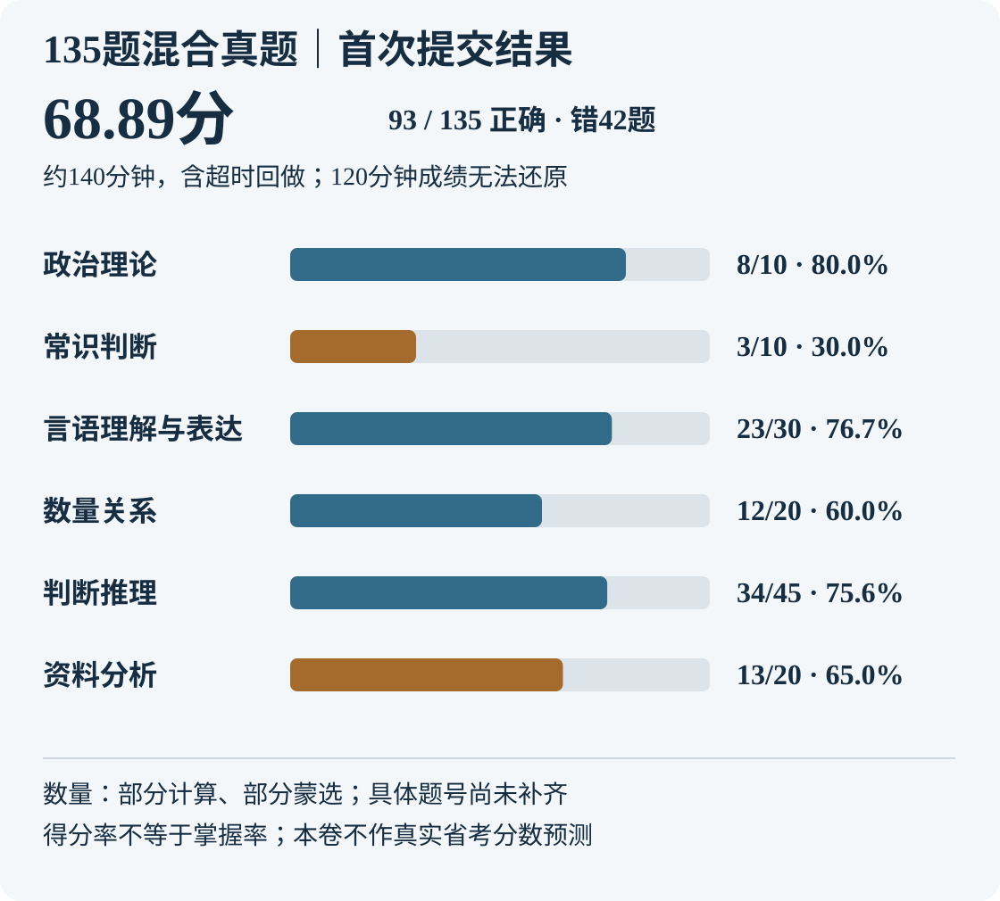

# 135题综合检测｜93／135，超时完成68.89分

**首次提交135个选项，答对93题、答错42题；等题赋分68.89／100。** 总用时据本人自报约140分钟（超时约20分钟），资料分析33分钟。提交答案含超时后的回做，不能当作120分钟限时成绩。

[原试卷](/daily-quizzes/2026-11-07-xingce-135) · [本人首次提交](/daily-quizzes/2026-11-07-xingce-135-answer) · [42道错题待复盘](/cuotiben/135题混合真题批改-2026-11-07)

<a href="/xuexi-notes/daily-quizzes/assets/2026-11-07-xingce-135-score.svg" target="_blank" rel="noopener">放大查看成绩图</a>

## 分模块结果

| 模块 | 正确／题数 | 得分率 | 时间与状态 |
|---|---:|---:|---|
| 政治理论 | 8/10 | 80.0% | 用时、把握度未单独报告 |
| 常识判断 | 3/10 | 30.0% | 用时、把握度未单独报告 |
| 言语理解与表达 | 23/30 | 76.7% | 用时、把握度未单独报告 |
| 数量关系 | 12/20 | 60.0% | 部分计算、部分蒙选；具体题号待补 |
| 判断推理 | 34/45 | 75.6% | 自述“没细看，应该超了十分钟以上”；具体分钟未知 |
| 资料分析 | 13/20 | 65.0% | 33分钟；7道错题待听列式 |

判断推理拆分：图形5／10、定义9／10、类比8／10、逻辑12／15。言语按本卷结构：选词填空6／10、片段与语句13／15、文章阅读4／5。数量按结构：数字推理4／5、数学运算8／15；部分蒙选尚不能逐题标注。

## 计分与时间边界

$$\frac{93}{135}\times100=68.89$$

- **68.89是超时完成的学习性参考分**，不是江苏官方单题权重，也不直接预测正式考试得分或排名。
- 本人记不清120分钟时的完成题号，并确认超时后回做。120分钟答案与分数留空；不按120÷140线性扣分，不把超时20分钟硬换成某个限时分。
- 数量20题都有提交选项，故全部照选项判分；本人确认部分计算、部分蒙选，具体题号未知。既不把20题全部判未作答，也不把12道答对记为独立掌握。
- 总用时约140分钟是120＋自报约20的估算，精确总分钟留空；判断推理无明确原计划或实测时长，不擅自记成45、50或55分钟。单题用时未知，不给整组每题强贴耗时标签。
- 当前是首次**提交**记录，不代表120分钟时的初始选择。实际作答日未单独确认，提交与评分日为2026-11-07。

## 先复盘哪里

1. **先拆资料7道错题**：116、118、120、127、128、131、133。沿用已有“先认对象／时期／单位，再列目标式，最后计算核对”的步骤，先听本人原式，区分口径、读数、计算与时间问题，不先归因为粗心。
2. **图形本卷5／10，单列核对起手方法**：72、74、75、78、79。只是本卷表现，不能以10题直接判定整个图形模块水平。
3. **常识本卷3／10，按具体知识点补漏**；政治8／10、言语23／30和判断34／45仍需保留熟题、猜选情况，当前没有稳定掌握证据。

数量先补“哪些题算过、哪些题蒙选”的题号，再定优先级；不根据这次时间不足，把数量统一判为不会。已有资料方法见[读数、口径与百化分](/xingce/资料分析读数与百化分速查)。

## 完整答案核对

每行保留原始十题分组；最后一行5题。参考列依据出卷前封存题库参考，与本轮计算校验一致；不称官方答案。

| 题号 | 本人首次提交 | 参考 | 本组正确 |
|---|---|---|---:|
| 1—10 | CDDAAABDCA | CBDAABBDCA | 8/10 |
| 11—20 | BCAAABAADC | DAAABCCABD | 3/10 |
| 21—30 | DACCDBBAAD | AADBDBBDAD | 6/10 |
| 31—40 | CCCADBCABA | CCCABDCABA | 8/10 |
| 41—50 | DBDDCBCABD | DBDDCACABD | 9/10 |
| 51—60 | BAACCBADAC | BCACCBDCDC | 6/10 |
| 61—70 | CBBDDAACCC | CCBDDDAABC | 6/10 |
| 71—80 | CDDDBBCCDB | CCDBABCDCB | 5/10 |
| 81—90 | ADABDDDACC | ADDBDDDACC | 9/10 |
| 91—100 | DBDCCCDBDA | DBDCCADCDA | 8/10 |
| 101—110 | BCDDBADBAD | BCDBBADBAD | 9/10 |
| 111—120 | DAAADBDBCA | DBABDADCCB | 5/10 |
| 121—130 | CCADBACDBB | CCADBADBBB | 8/10 |
| 131—135 | DDACD | ADBCD | 3/5 |

## 按模块核对题号

| 模块 | 错题题号 |
|---|---|
| 政治理论 | [2](/cuotiben/135题混合真题批改-2026-11-07#q2)、[6](/cuotiben/135题混合真题批改-2026-11-07#q6) |
| 常识判断 | [11](/cuotiben/135题混合真题批改-2026-11-07#q11)、[12](/cuotiben/135题混合真题批改-2026-11-07#q12)、[15](/cuotiben/135题混合真题批改-2026-11-07#q15)、[16](/cuotiben/135题混合真题批改-2026-11-07#q16)、[17](/cuotiben/135题混合真题批改-2026-11-07#q17)、[19](/cuotiben/135题混合真题批改-2026-11-07#q19)、[20](/cuotiben/135题混合真题批改-2026-11-07#q20) |
| 言语理解与表达 | [21](/cuotiben/135题混合真题批改-2026-11-07#q21)、[23](/cuotiben/135题混合真题批改-2026-11-07#q23)、[24](/cuotiben/135题混合真题批改-2026-11-07#q24)、[28](/cuotiben/135题混合真题批改-2026-11-07#q28)、[35](/cuotiben/135题混合真题批改-2026-11-07#q35)、[36](/cuotiben/135题混合真题批改-2026-11-07#q36)、[46](/cuotiben/135题混合真题批改-2026-11-07#q46) |
| 数量关系 | [52](/cuotiben/135题混合真题批改-2026-11-07#q52)、[57](/cuotiben/135题混合真题批改-2026-11-07#q57)、[58](/cuotiben/135题混合真题批改-2026-11-07#q58)、[59](/cuotiben/135题混合真题批改-2026-11-07#q59)、[62](/cuotiben/135题混合真题批改-2026-11-07#q62)、[66](/cuotiben/135题混合真题批改-2026-11-07#q66)、[68](/cuotiben/135题混合真题批改-2026-11-07#q68)、[69](/cuotiben/135题混合真题批改-2026-11-07#q69) |
| 判断推理 | [72](/cuotiben/135题混合真题批改-2026-11-07#q72)、[74](/cuotiben/135题混合真题批改-2026-11-07#q74)、[75](/cuotiben/135题混合真题批改-2026-11-07#q75)、[78](/cuotiben/135题混合真题批改-2026-11-07#q78)、[79](/cuotiben/135题混合真题批改-2026-11-07#q79)、[83](/cuotiben/135题混合真题批改-2026-11-07#q83)、[96](/cuotiben/135题混合真题批改-2026-11-07#q96)、[98](/cuotiben/135题混合真题批改-2026-11-07#q98)、[104](/cuotiben/135题混合真题批改-2026-11-07#q104)、[112](/cuotiben/135题混合真题批改-2026-11-07#q112)、[114](/cuotiben/135题混合真题批改-2026-11-07#q114) |
| 资料分析 | [116](/cuotiben/135题混合真题批改-2026-11-07#q116)、[118](/cuotiben/135题混合真题批改-2026-11-07#q118)、[120](/cuotiben/135题混合真题批改-2026-11-07#q120)、[127](/cuotiben/135题混合真题批改-2026-11-07#q127)、[128](/cuotiben/135题混合真题批改-2026-11-07#q128)、[131](/cuotiben/135题混合真题批改-2026-11-07#q131)、[133](/cuotiben/135题混合真题批改-2026-11-07#q133) |

## 逐题判分

下方仅逐题判分。具体思路、单题用时、熟题与不确定题未提供，均保留待补；批改归档不等于逐题复盘完成。

| 题号 | 首次提交 | 参考 | 结果 |
|---|---|---|---|
| [1](/daily-quizzes/2026-11-07-xingce-135#q1) | C | C | 答对；掌握待验证 |
| [2](/daily-quizzes/2026-11-07-xingce-135#q2) | D | B | [错题，待复盘](/cuotiben/135题混合真题批改-2026-11-07#q2) |
| [3](/daily-quizzes/2026-11-07-xingce-135#q3) | D | D | 答对；掌握待验证 |
| [4](/daily-quizzes/2026-11-07-xingce-135#q4) | A | A | 答对；掌握待验证 |
| [5](/daily-quizzes/2026-11-07-xingce-135#q5) | A | A | 答对；掌握待验证 |
| [6](/daily-quizzes/2026-11-07-xingce-135#q6) | A | B | [错题，待复盘](/cuotiben/135题混合真题批改-2026-11-07#q6) |
| [7](/daily-quizzes/2026-11-07-xingce-135#q7) | B | B | 答对；掌握待验证 |
| [8](/daily-quizzes/2026-11-07-xingce-135#q8) | D | D | 答对；掌握待验证 |
| [9](/daily-quizzes/2026-11-07-xingce-135#q9) | C | C | 答对；掌握待验证 |
| [10](/daily-quizzes/2026-11-07-xingce-135#q10) | A | A | 答对；掌握待验证 |
| [11](/daily-quizzes/2026-11-07-xingce-135#q11) | B | D | [错题，待复盘](/cuotiben/135题混合真题批改-2026-11-07#q11) |
| [12](/daily-quizzes/2026-11-07-xingce-135#q12) | C | A | [错题，待复盘](/cuotiben/135题混合真题批改-2026-11-07#q12) |
| [13](/daily-quizzes/2026-11-07-xingce-135#q13) | A | A | 答对；掌握待验证 |
| [14](/daily-quizzes/2026-11-07-xingce-135#q14) | A | A | 答对；掌握待验证 |
| [15](/daily-quizzes/2026-11-07-xingce-135#q15) | A | B | [错题，待复盘](/cuotiben/135题混合真题批改-2026-11-07#q15) |
| [16](/daily-quizzes/2026-11-07-xingce-135#q16) | B | C | [错题，待复盘](/cuotiben/135题混合真题批改-2026-11-07#q16) |
| [17](/daily-quizzes/2026-11-07-xingce-135#q17) | A | C | [错题，待复盘](/cuotiben/135题混合真题批改-2026-11-07#q17) |
| [18](/daily-quizzes/2026-11-07-xingce-135#q18) | A | A | 答对；掌握待验证 |
| [19](/daily-quizzes/2026-11-07-xingce-135#q19) | D | B | [错题，待复盘](/cuotiben/135题混合真题批改-2026-11-07#q19) |
| [20](/daily-quizzes/2026-11-07-xingce-135#q20) | C | D | [错题，待复盘](/cuotiben/135题混合真题批改-2026-11-07#q20) |
| [21](/daily-quizzes/2026-11-07-xingce-135#q21) | D | A | [错题，待复盘](/cuotiben/135题混合真题批改-2026-11-07#q21) |
| [22](/daily-quizzes/2026-11-07-xingce-135#q22) | A | A | 答对；掌握待验证 |
| [23](/daily-quizzes/2026-11-07-xingce-135#q23) | C | D | [错题，待复盘](/cuotiben/135题混合真题批改-2026-11-07#q23) |
| [24](/daily-quizzes/2026-11-07-xingce-135#q24) | C | B | [错题，待复盘](/cuotiben/135题混合真题批改-2026-11-07#q24) |
| [25](/daily-quizzes/2026-11-07-xingce-135#q25) | D | D | 答对；掌握待验证 |
| [26](/daily-quizzes/2026-11-07-xingce-135#q26) | B | B | 答对；掌握待验证 |
| [27](/daily-quizzes/2026-11-07-xingce-135#q27) | B | B | 答对；掌握待验证 |
| [28](/daily-quizzes/2026-11-07-xingce-135#q28) | A | D | [错题，待复盘](/cuotiben/135题混合真题批改-2026-11-07#q28) |
| [29](/daily-quizzes/2026-11-07-xingce-135#q29) | A | A | 答对；掌握待验证 |
| [30](/daily-quizzes/2026-11-07-xingce-135#q30) | D | D | 答对；掌握待验证 |
| [31](/daily-quizzes/2026-11-07-xingce-135#q31) | C | C | 答对；掌握待验证 |
| [32](/daily-quizzes/2026-11-07-xingce-135#q32) | C | C | 答对；掌握待验证 |
| [33](/daily-quizzes/2026-11-07-xingce-135#q33) | C | C | 答对；掌握待验证 |
| [34](/daily-quizzes/2026-11-07-xingce-135#q34) | A | A | 答对；掌握待验证 |
| [35](/daily-quizzes/2026-11-07-xingce-135#q35) | D | B | [错题，待复盘](/cuotiben/135题混合真题批改-2026-11-07#q35) |
| [36](/daily-quizzes/2026-11-07-xingce-135#q36) | B | D | [错题，待复盘](/cuotiben/135题混合真题批改-2026-11-07#q36) |
| [37](/daily-quizzes/2026-11-07-xingce-135#q37) | C | C | 答对；掌握待验证 |
| [38](/daily-quizzes/2026-11-07-xingce-135#q38) | A | A | 答对；掌握待验证 |
| [39](/daily-quizzes/2026-11-07-xingce-135#q39) | B | B | 答对；掌握待验证 |
| [40](/daily-quizzes/2026-11-07-xingce-135#q40) | A | A | 答对；掌握待验证 |
| [41](/daily-quizzes/2026-11-07-xingce-135#q41) | D | D | 答对；掌握待验证 |
| [42](/daily-quizzes/2026-11-07-xingce-135#q42) | B | B | 答对；掌握待验证 |
| [43](/daily-quizzes/2026-11-07-xingce-135#q43) | D | D | 答对；掌握待验证 |
| [44](/daily-quizzes/2026-11-07-xingce-135#q44) | D | D | 答对；掌握待验证 |
| [45](/daily-quizzes/2026-11-07-xingce-135#q45) | C | C | 答对；掌握待验证 |
| [46](/daily-quizzes/2026-11-07-xingce-135#q46) | B | A | [错题，待复盘](/cuotiben/135题混合真题批改-2026-11-07#q46) |
| [47](/daily-quizzes/2026-11-07-xingce-135#q47) | C | C | 答对；掌握待验证 |
| [48](/daily-quizzes/2026-11-07-xingce-135#q48) | A | A | 答对；掌握待验证 |
| [49](/daily-quizzes/2026-11-07-xingce-135#q49) | B | B | 答对；掌握待验证 |
| [50](/daily-quizzes/2026-11-07-xingce-135#q50) | D | D | 答对；掌握待验证 |
| [51](/daily-quizzes/2026-11-07-xingce-135#q51) | B | B | 答对；掌握待验证 |
| [52](/daily-quizzes/2026-11-07-xingce-135#q52) | A | C | [错题，待复盘](/cuotiben/135题混合真题批改-2026-11-07#q52) |
| [53](/daily-quizzes/2026-11-07-xingce-135#q53) | A | A | 答对；掌握待验证 |
| [54](/daily-quizzes/2026-11-07-xingce-135#q54) | C | C | 答对；掌握待验证 |
| [55](/daily-quizzes/2026-11-07-xingce-135#q55) | C | C | 答对；掌握待验证 |
| [56](/daily-quizzes/2026-11-07-xingce-135#q56) | B | B | 答对；掌握待验证 |
| [57](/daily-quizzes/2026-11-07-xingce-135#q57) | A | D | [错题，待复盘](/cuotiben/135题混合真题批改-2026-11-07#q57) |
| [58](/daily-quizzes/2026-11-07-xingce-135#q58) | D | C | [错题，待复盘](/cuotiben/135题混合真题批改-2026-11-07#q58) |
| [59](/daily-quizzes/2026-11-07-xingce-135#q59) | A | D | [错题，待复盘](/cuotiben/135题混合真题批改-2026-11-07#q59) |
| [60](/daily-quizzes/2026-11-07-xingce-135#q60) | C | C | 答对；掌握待验证 |
| [61](/daily-quizzes/2026-11-07-xingce-135#q61) | C | C | 答对；掌握待验证 |
| [62](/daily-quizzes/2026-11-07-xingce-135#q62) | B | C | [错题，待复盘](/cuotiben/135题混合真题批改-2026-11-07#q62) |
| [63](/daily-quizzes/2026-11-07-xingce-135#q63) | B | B | 答对；掌握待验证 |
| [64](/daily-quizzes/2026-11-07-xingce-135#q64) | D | D | 答对；掌握待验证 |
| [65](/daily-quizzes/2026-11-07-xingce-135#q65) | D | D | 答对；掌握待验证 |
| [66](/daily-quizzes/2026-11-07-xingce-135#q66) | A | D | [错题，待复盘](/cuotiben/135题混合真题批改-2026-11-07#q66) |
| [67](/daily-quizzes/2026-11-07-xingce-135#q67) | A | A | 答对；掌握待验证 |
| [68](/daily-quizzes/2026-11-07-xingce-135#q68) | C | A | [错题，待复盘](/cuotiben/135题混合真题批改-2026-11-07#q68) |
| [69](/daily-quizzes/2026-11-07-xingce-135#q69) | C | B | [错题，待复盘](/cuotiben/135题混合真题批改-2026-11-07#q69) |
| [70](/daily-quizzes/2026-11-07-xingce-135#q70) | C | C | 答对；掌握待验证 |
| [71](/daily-quizzes/2026-11-07-xingce-135#q71) | C | C | 答对；掌握待验证 |
| [72](/daily-quizzes/2026-11-07-xingce-135#q72) | D | C | [错题，待复盘](/cuotiben/135题混合真题批改-2026-11-07#q72) |
| [73](/daily-quizzes/2026-11-07-xingce-135#q73) | D | D | 答对；掌握待验证 |
| [74](/daily-quizzes/2026-11-07-xingce-135#q74) | D | B | [错题，待复盘](/cuotiben/135题混合真题批改-2026-11-07#q74) |
| [75](/daily-quizzes/2026-11-07-xingce-135#q75) | B | A | [错题，待复盘](/cuotiben/135题混合真题批改-2026-11-07#q75) |
| [76](/daily-quizzes/2026-11-07-xingce-135#q76) | B | B | 答对；掌握待验证 |
| [77](/daily-quizzes/2026-11-07-xingce-135#q77) | C | C | 答对；掌握待验证 |
| [78](/daily-quizzes/2026-11-07-xingce-135#q78) | C | D | [错题，待复盘](/cuotiben/135题混合真题批改-2026-11-07#q78) |
| [79](/daily-quizzes/2026-11-07-xingce-135#q79) | D | C | [错题，待复盘](/cuotiben/135题混合真题批改-2026-11-07#q79) |
| [80](/daily-quizzes/2026-11-07-xingce-135#q80) | B | B | 答对；掌握待验证 |
| [81](/daily-quizzes/2026-11-07-xingce-135#q81) | A | A | 答对；掌握待验证 |
| [82](/daily-quizzes/2026-11-07-xingce-135#q82) | D | D | 答对；掌握待验证 |
| [83](/daily-quizzes/2026-11-07-xingce-135#q83) | A | D | [错题，待复盘](/cuotiben/135题混合真题批改-2026-11-07#q83) |
| [84](/daily-quizzes/2026-11-07-xingce-135#q84) | B | B | 答对；掌握待验证 |
| [85](/daily-quizzes/2026-11-07-xingce-135#q85) | D | D | 答对；掌握待验证 |
| [86](/daily-quizzes/2026-11-07-xingce-135#q86) | D | D | 答对；掌握待验证 |
| [87](/daily-quizzes/2026-11-07-xingce-135#q87) | D | D | 答对；掌握待验证 |
| [88](/daily-quizzes/2026-11-07-xingce-135#q88) | A | A | 答对；掌握待验证 |
| [89](/daily-quizzes/2026-11-07-xingce-135#q89) | C | C | 答对；掌握待验证 |
| [90](/daily-quizzes/2026-11-07-xingce-135#q90) | C | C | 答对；掌握待验证 |
| [91](/daily-quizzes/2026-11-07-xingce-135#q91) | D | D | 答对；掌握待验证 |
| [92](/daily-quizzes/2026-11-07-xingce-135#q92) | B | B | 答对；掌握待验证 |
| [93](/daily-quizzes/2026-11-07-xingce-135#q93) | D | D | 答对；掌握待验证 |
| [94](/daily-quizzes/2026-11-07-xingce-135#q94) | C | C | 答对；掌握待验证 |
| [95](/daily-quizzes/2026-11-07-xingce-135#q95) | C | C | 答对；掌握待验证 |
| [96](/daily-quizzes/2026-11-07-xingce-135#q96) | C | A | [错题，待复盘](/cuotiben/135题混合真题批改-2026-11-07#q96) |
| [97](/daily-quizzes/2026-11-07-xingce-135#q97) | D | D | 答对；掌握待验证 |
| [98](/daily-quizzes/2026-11-07-xingce-135#q98) | B | C | [错题，待复盘](/cuotiben/135题混合真题批改-2026-11-07#q98) |
| [99](/daily-quizzes/2026-11-07-xingce-135#q99) | D | D | 答对；掌握待验证 |
| [100](/daily-quizzes/2026-11-07-xingce-135#q100) | A | A | 答对；掌握待验证 |
| [101](/daily-quizzes/2026-11-07-xingce-135#q101) | B | B | 答对；掌握待验证 |
| [102](/daily-quizzes/2026-11-07-xingce-135#q102) | C | C | 答对；掌握待验证 |
| [103](/daily-quizzes/2026-11-07-xingce-135#q103) | D | D | 答对；掌握待验证 |
| [104](/daily-quizzes/2026-11-07-xingce-135#q104) | D | B | [错题，待复盘](/cuotiben/135题混合真题批改-2026-11-07#q104) |
| [105](/daily-quizzes/2026-11-07-xingce-135#q105) | B | B | 答对；掌握待验证 |
| [106](/daily-quizzes/2026-11-07-xingce-135#q106) | A | A | 答对；掌握待验证 |
| [107](/daily-quizzes/2026-11-07-xingce-135#q107) | D | D | 答对；掌握待验证 |
| [108](/daily-quizzes/2026-11-07-xingce-135#q108) | B | B | 答对；掌握待验证 |
| [109](/daily-quizzes/2026-11-07-xingce-135#q109) | A | A | 答对；掌握待验证 |
| [110](/daily-quizzes/2026-11-07-xingce-135#q110) | D | D | 答对；掌握待验证 |
| [111](/daily-quizzes/2026-11-07-xingce-135#q111) | D | D | 答对；掌握待验证 |
| [112](/daily-quizzes/2026-11-07-xingce-135#q112) | A | B | [错题，待复盘](/cuotiben/135题混合真题批改-2026-11-07#q112) |
| [113](/daily-quizzes/2026-11-07-xingce-135#q113) | A | A | 答对；掌握待验证 |
| [114](/daily-quizzes/2026-11-07-xingce-135#q114) | A | B | [错题，待复盘](/cuotiben/135题混合真题批改-2026-11-07#q114) |
| [115](/daily-quizzes/2026-11-07-xingce-135#q115) | D | D | 答对；掌握待验证 |
| [116](/daily-quizzes/2026-11-07-xingce-135#q116) | B | A | [错题，待复盘](/cuotiben/135题混合真题批改-2026-11-07#q116) |
| [117](/daily-quizzes/2026-11-07-xingce-135#q117) | D | D | 答对；掌握待验证 |
| [118](/daily-quizzes/2026-11-07-xingce-135#q118) | B | C | [错题，待复盘](/cuotiben/135题混合真题批改-2026-11-07#q118) |
| [119](/daily-quizzes/2026-11-07-xingce-135#q119) | C | C | 答对；掌握待验证 |
| [120](/daily-quizzes/2026-11-07-xingce-135#q120) | A | B | [错题，待复盘](/cuotiben/135题混合真题批改-2026-11-07#q120) |
| [121](/daily-quizzes/2026-11-07-xingce-135#q121) | C | C | 答对；掌握待验证 |
| [122](/daily-quizzes/2026-11-07-xingce-135#q122) | C | C | 答对；掌握待验证 |
| [123](/daily-quizzes/2026-11-07-xingce-135#q123) | A | A | 答对；掌握待验证 |
| [124](/daily-quizzes/2026-11-07-xingce-135#q124) | D | D | 答对；掌握待验证 |
| [125](/daily-quizzes/2026-11-07-xingce-135#q125) | B | B | 答对；掌握待验证 |
| [126](/daily-quizzes/2026-11-07-xingce-135#q126) | A | A | 答对；掌握待验证 |
| [127](/daily-quizzes/2026-11-07-xingce-135#q127) | C | D | [错题，待复盘](/cuotiben/135题混合真题批改-2026-11-07#q127) |
| [128](/daily-quizzes/2026-11-07-xingce-135#q128) | D | B | [错题，待复盘](/cuotiben/135题混合真题批改-2026-11-07#q128) |
| [129](/daily-quizzes/2026-11-07-xingce-135#q129) | B | B | 答对；掌握待验证 |
| [130](/daily-quizzes/2026-11-07-xingce-135#q130) | B | B | 答对；掌握待验证 |
| [131](/daily-quizzes/2026-11-07-xingce-135#q131) | D | A | [错题，待复盘](/cuotiben/135题混合真题批改-2026-11-07#q131) |
| [132](/daily-quizzes/2026-11-07-xingce-135#q132) | D | D | 答对；掌握待验证 |
| [133](/daily-quizzes/2026-11-07-xingce-135#q133) | A | B | [错题，待复盘](/cuotiben/135题混合真题批改-2026-11-07#q133) |
| [134](/daily-quizzes/2026-11-07-xingce-135#q134) | C | C | 答对；掌握待验证 |
| [135](/daily-quizzes/2026-11-07-xingce-135#q135) | D | D | 答对；掌握待验证 |

## 记录来源

依据本聊天原始答串及两项补充确认，保存未改写提交记录；题库参考取自本卷固定版次题源。数量20、资料20、组合逻辑5已在出卷时独立计算／枚举，原文及原图已留存。当前未逐题听本人思路，不补造错误原因，不把不同卷型、时长和题源的成绩直接解读为进步或退步。
